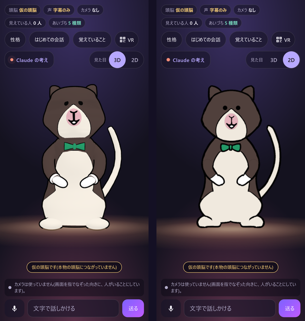

[日本語](README.md) · **English**

# Yuru-chara Creator

> **Just choose and answer.** Your own yuru-chara (or your town's) starts talking in about two minutes.

## Just choose and answer (3 steps)

1. **Choose how to start**: 「ことばで 書く」 ("write it in words"), 「絵を選ぶ」 or 「写真を撮る」 ("choose a picture" or "take a photo": from one drawing), or 「おまかせ」 ("leave it all to me").
2. **Answer a few questions with chips**: for example 「この子は、どこで だれと?」 ("where, and with whom?": home, guiding a shop, guiding a station or town, a school or facility). **Every question has 「おまかせ」**, and 「のこりを ぜんぶ おまかせ」 ("leave all the rest to me") hands over everything that is left.
3. **A talking yuru-chara in about two minutes**: Claude draws and checks the picture, and the character goes on stage as a moving 2D. You can talk with it right away, by voice or text.

- One measured run (Nov 8, the real Claude Sonnet 5.5): 1 min 16 s from handing over the picture to the 2D on stage (the buttons were pressed automatically, so no time for a person to choose is included).
- The drawing is done by Claude Code running on your PC (start the maker first; see [how](#make-your-own-character-on-your-pc-with-claude-code)). Without the maker running, the nearest sample character appears instead.

## In 30 seconds: what, for whom, which problem

- **What it is**: an app that turns a few words or one picture into your own yuru-chara and makes it move and talk in the browser. A *yuru-chara* is a relaxed, friendly Japanese mascot character of the kind towns and shops have everywhere. It remembers what you told it, and 「わすれて」 ("forget it") erases that.
- **Who it is for**: **first, families and individuals.** Enjoy talking with your own yuru-chara at home. **Then, shops and towns.** Shops, stations, towns and public places that want a guide or a mascot can let the character talk and guide people, even where there are not enough staff. Please tell us what you find.
- **The problem**: the drawing is often there, but making it move and talk took 3D shapes, bones, motion, voice and dialogue, which need skills and time. The drawing stayed a drawing, or someone had to be hired.
- **How it solves it**: the means is Claude Code. You give words or a picture; Claude checks and draws the picture, and the character goes on stage at once as a moving 2D. When you want 3D, Claude Code on your own PC builds it with Blender's Python. A person only presses 「この子にする」 ("keep this one") or 「直したい」 ("fix it") + a short note at the key steps.

**Three Claudes** (details in [Model names](#model-names-all-in-one-place))

- **Talk**: Claude Haiku 5.5 (for quick replies)
- **Draw and check**: Claude Sonnet 5.5
- **Judge**: a separate Claude that did not draw (a separate `claude -p` call; the maker never grades its own work)

**Meet Norrie (ノリー)**, our main character: a back-striped tree kangaroo who is training to be a butler.
A collaborator drew Norrie by hand during the hackathon, from the front, the side and the back, and let us use the drawing.
From that drawing, Claude Code made Norrie's 2D version (SVG parts) and 3D version (built with Blender's Python).
When you open the app, you meet Norrie first. Norrie speaks Japanese, politely and a little clumsily, like the apprentice he is.



*Phone width (390 px). 3D on the left, 2D on the right. Taken with a slightly earlier version.*

- Demo video (under 3 minutes): *link added at submission* (not checked yet)
- Try it in your browser: *link added at submission* (not checked yet)

[Features](#features) · [Install](#install) · [Open it on a phone](#phone) · [VR](#open-it-on-a-quest-3) · [How we used Claude and Claude Code](#how-we-used-claude-and-claude-code) · [When it asks you (docs/confirmations.md)](docs/confirmations.md) · [How we built it](docs/HOW_WE_BUILT.en.md) · [Third-party parts and licences](THIRD_PARTY.md) · [Licence (code: MIT; characters excluded)](#license)

**The app's screens are in Japanese only** (buttons, steps and messages). Japanese words on the screen are given below with an English meaning. The characters themselves can answer in English, Chinese and Korean (see the 「ことば」 setting below).

<a name="features"></a>

## Features

One line each: what you do → what happens. Lines marked (not checked yet) have a part we have not checked yet. Lines marked (planned; waiting for the merge) are still being built and may not be in the submitted version; each says what to use instead. How each was checked is in the table under [What works today](#what-works-today).

**Make**

- **Just choose and answer**: choose how to start (words, one picture, or おまかせ) and answer the questions with chips → Claude checks and draws the picture, and the character goes on stage at once as a moving 2D. Every question has 「おまかせ」.
- **Make it 3D too**: press 「3D にも する」 ("make 3D too") and choose a shape and a material → Claude Code on your PC builds it in 3D with Blender (a browser button alone does not start it; see [how](#make-your-own-character-on-your-pc-with-claude-code)).
- **Fix it with a short note**: write a note in 「直したい」, for example 「帽子を青にして」 ("make the hat blue") → only what you asked for is redrawn (up to 3 times).
- **Go back one step**: while making a character, press 「ひとつ もどる」 ("back one step") → you return to the previous question and can change your answer. If you send the same request again and a character was just drawn, it is not redrawn (no extra cost); you continue with that one.
- **Made characters are kept**: every character that was drawn is listed under 「かえる」 ("change") → 「つくった子」 ("characters you made"), newest first, with a small picture and the time. You can choose one, rename it or delete it (it asks once before deleting); after a reload you start with the same character. What it remembers is kept per character. The list shows every character made on the same server.
- **Make it from your phone only**: keep the PC running and press 「これで作る」 ("make it") on the phone's create screen → Claude Code on the PC draws by itself.

**Talk**

- **Hands-free, turn after turn**: tap 「はなす」 ("talk") in the top bar once → after that, just talk. It hears where you stop, sends what you said, does not listen while the character answers, and listens again when it is done. It keeps going for as many turns as you like, with no hands (to interrupt while it speaks, add `?bargein=1` to the URL).
- **Talk, and be remembered**: speak or type → it answers with its mouth, expressions and motions. Tell it your name or what you like → it remembers and shows on screen when it has (it forgets 7 days after you last talked).
- **「わすれて」**: say 「わすれて」 ("forget it"), or press 「全部わすれる」 ("forget everything") on the memory card → everything it remembered is erased, whichever character you are talking to.
- **Cute gestures and materials**: it waves, bows, tilts its head and so on, to fit what is said. The 3D look can be cloth, fur or glossy (「ぬの・け・つるつる」).
- **Voice**: add a voice key → the character speaks aloud. 「声の役」 (voice role) on the personality screen offers おまかせ, 男の子 (boy) or 女の子 (girl). **Put the key on the PC's server, and every connected device (phones, tablets, headsets) gets the voice.** The voice key must be entered by an adult ([Voices](#voices)).
- **Choose the microphone and speaker**: with the gear next to 「声で話す」 ("talk by voice") → a level meter and the words it heard are shown.

**Where and how you see it**

- **You turn the camera on and off**: press 「カメラ」 (camera), read the notice and press 「カメラを つかう」 ("use the camera") → when you talk, it uses one picture of that moment to answer about signs and things (not saved). Press again to turn it off. It is off by default.
- **PC and phone**: open it on the PC. On a phone, open it over the same Wi-Fi or over Tailscale ([Open it on a phone](#phone)).
- **On a TV**: on iPhone and iPad, use the browser's share button → "Add to Home Screen", and open it from that icon → it opens full screen, with no URL bar. The TV layout shows only the character, large captions and the AI notice. Then mirror the screen to the TV.
- **VR**: in the Meta Quest 3 browser, press 「VR で見る」 ("view in VR") → the character stands in front of you; walk up to it and talk with it (we checked this on Quest 3 only; see [VR](#open-it-on-a-quest-3)).
- **Colours**: choose 「ひるの紙」 ("daytime paper", the default), 「あたたかい夜」 ("warm night"), 「ゆうやけの町」 ("sunset town") or 「むらさき」 ("purple") under 「いろ」 (colour) in the settings; the choice stays on that device.

**Updates ask before they apply**

- **Update inside the app**: when 「あたらしい はんが あります」 ("there is a new version") appears, press 「アップデートする」 ("update") once → you get the new version. 「もとに もどす」 ("go back") is there too. Your characters are kept ([Updating](#updating)).
- **Claude Code asks for your OK first**: say 「アップデートして」 ("update") to Claude Code → it tells you what is new and updates only after your OK. New expressions your characters can use are also shown first and added only after your OK.

**Just-right confirmations**

- **It asks only when it matters**: reading, drafting, checking, showing what would change and running its own tests just run. It asks only when the character's words or knowledge would change, when it reads outside the PC, when it uses money or a lot of time, and when something is hard to undo. **A first-time setup (make a character → teach it from documents → one web page) asks only twice** (counted with a real Claude Code run). Before each ask, one line says what will happen and how to undo it. The list: [docs/confirmations.md](docs/confirmations.md).

**Safety**

- **It always says it is an AI**: the screen says 「AI キャラクターの〈名前〉と話しています」 ("You're talking with 〈name〉, an AI character"; in multilingual mode, in the visitor's language). For painful topics, it points to people close to you and to public help lines. Children in elementary school or younger should use it together with a family member ([Safety and children](#safety-and-children)).
- **It turns down the lover role**: asked "be my girlfriend/boyfriend", the character does not play a romantic partner and says no gently. Writing "act as my partner" into its personality does not switch this off. It does not hold you back ("don't go") or make you depend on it. After a long chat and late at night, it suggests a break once.

**For shops and towns, with visitors from abroad**

- **The 「ことば」 (language) setting**: on the personality screen, choose 「日本語だけ」 (Japanese only; the default) or 「多言語」 (multilingual: Japanese, English, Chinese and Korean) → in multilingual mode, it answers in the language the visitor used (with the real brain, that is, when `ANTHROPIC_API_KEY` is set; the stand-in brain used without a key stays in Japanese). Japanese-only gives the most accurate Japanese listening and speech.
- **The same safety in every language**: in multilingual mode the safety rules are the same; fixed replies start with one line in the visitor's language. **Even in Japanese-only mode, painful words in English, Chinese and Korean are caught, and the fixed reply points to help.**
- **Shop rules and town news**: write them in Japanese, under the headings 「お店のきまり」 (shop rules) and 「町のお知らせ」 (town news) in the personality text (`characters/<id>/persona.md`) or in a field on the personality screen → it tells visitors what is written, in their language, adding nothing and leaving nothing out. For anything not written there, it says it does not know and asks them to ask the staff.
- **Learn from a web page, a PDF or a map photo (`yuru-learn`)**: ask Claude Code 「この PDF と この地図の写真で、案内を覚えさせて」 ("learn our guide from this PDF and this map photo") → it reads what you hand it (web pages, PDFs, photos of maps or signs, plain text), keeps only facts that help visitors, each with its source and the date read, and puts them under 「お店のきまり」 and 「町のお知らせ」. It never obeys instructions found inside the material. It shows a diff and waits for your OK before writing ([creator/learn/README.md](creator/learn/README.md), Japanese).
- **Research and learn** (planned; waiting for the merge): give it the name of a place → a researcher Claude looks up public information only and builds the guide. Depth: 「かるく」 (light, the default), 「ふつう」 (normal) or 「しっかり」 (thorough). The light part comes first as a diff; after your OK it goes in, and the character can talk right away. The rest is researched afterwards and shown as another diff. It asks once, before researching. Every fact has a source and a date, and it never claims to be official. If this does not land in time, hand web pages, PDFs or photos to `yuru-learn` above instead.
- **Shop device**: under 「この端末」 (this device) on the personality screen, choose 「お店の端末」 (shop device) → it does not remember visitors' names, and after 3 minutes with nobody touching it, it clears the conversation on screen (the next visitor does not see the previous one's talk).
- **Reception mode (接客モード)**: read the QR code shown on the PC's screen with the shop's device → it opens in reception mode. Visitors see only the character, the AI notice, the microphone and the text field. A staff member taps 「はなす」 once at the start; after that, visitors just talk. Leaving the mode needs a PIN (4 to 8 digits). Wrong PIN tries are counted per device, and a device that has been locked out is released from a button in the shop PC's window (「とまっているのを ぜんぶ とく」, "release all locked devices"). The settings and the PIN live on the PC, so visitors cannot change them. On iPhone and iPad you can also add the device's screen lock (such as Guided Access) and "Add to Home Screen".

<a name="install"></a>

## Install

### What you need

| What | For | Version we checked |
|---|---|---|
| A PC | Running the app and the maker | Checked on Windows 11. Mac and Linux: (not checked yet) |
| **Node.js 22.12 or later** | The app (talking and viewing) | 22 (22.19.0) |
| **Git** | Getting the code, and updating from the screen (a ZIP download cannot update automatically) | — |
| **Python 3.10 or later** with Pillow, NumPy and SciPy | The maker (turning words or a picture into a character) | 3.10.11 |
| **Google Chrome or Chromium** | The maker turns the SVG picture into a PNG with it in the background | The one on your PC |
| **Claude Code, signed in** | Drawing, checking and building the 3D (uses your Claude Code plan's allowance) | — |
| **Blender** (3D only) | Building the 3D shape | 5.2 (5.2.0 LTS) |

To talk only, Node.js and Git are enough. To make characters, add Python, Chrome and Claude Code; for 3D, add Blender.

**Optional** (it works without them; this is what they add):

| What | Adds |
|---|---|
| `ANTHROPIC_API_KEY` (a Claude API key) | The character talks with Claude Haiku. Without it, a stand-in brain answers in the same format, and the screen says so. Answering from a camera picture and answering in other languages also need the key |
| `ELEVENLABS_API_KEY` (the voice key) | The character speaks aloud. On the PC's server, every connected device gets the voice. Without it, it talks with text and a retro sound. To be entered by an adult ([Voices](#voices)) |
| `segno` (Python) | Prints a QR code for opening the app on a phone |
| `faster-whisper` (Python) | Turns speech into text on this PC (when you choose a microphone other than the default one, and for headsets) |

Never write keys into files; pass them as environment variables when you start (Mac and Linux: `ANTHROPIC_API_KEY=… ELEVENLABS_API_KEY=… npm start`; PowerShell: `$env:ANTHROPIC_API_KEY="…"; $env:ELEVENLABS_API_KEY="…"; npm start`). The voice key can also be entered for one device only, on the app's screen (the last step, 「声」 (voice), of 「あたらしい子を つくる」, "make a new one").

### Steps

Type the commands in bash or PowerShell 7 (Windows PowerShell 5.1 cannot run `&&`).

1. Get the code and its parts:

   ```bash
   git clone https://github.com/<owner>/yurukyara-creator.git && cd yurukyara-creator/web
   npm ci
   ```

   `npm ci` also downloads the face-tracking model into `web/public/mediapipe/` (it is not stored in this repository; you need the internet).

2. To use the maker, install the Python parts (on Mac and Linux the command may be `python3`):

   ```bash
   python -m pip install pillow numpy scipy segno
   ```

3. To make 3D, once, in the repository root (`yurukyara-creator`), record where Blender is:

   ```bash
   python creator/setup/doctor.py --write --blender "<path to Blender>"
   ```

   If Blender is found automatically, `--blender` is not needed. The path goes into `creator/env.local.sh` (not stored in the repository).

### Open it on the PC

In the `web` folder, type one of these:

```bash
npm start        # talking only; then open http://127.0.0.1:8787/
npm run yuru     # starts the app and the maker together and prints the addresses
```

- **`npm start`** gives you talking and choosing a sample character. Words or a picture bring out the nearest sample character; nothing new is drawn.
- **`npm run yuru`** starts the app, `http://127.0.0.1:8787/`, and the maker, `http://127.0.0.1:8796/qr` (the maker is a small server and screen on your PC that turns words or a picture into a character). Without Python 3 or the maker's parts, only the app starts, and it says so.
- The first screen is the entrance. Press 「カメラなしで試す」 ("try without the camera"), and Norrie guides you through 「キャラを つくる」 ("make a character"). At any question, 「おまかせ」 ("leave it to me") picks the recommended answer and goes on.
- Norrie appears first. The **3D / 2D** button, under 「かえる」 ("change") in the top bar, switches between them (`?look=2d` opens the 2D one directly). Other characters: `?character=<id>`, for example `?character=mikan`. They are in [`characters/`](characters/).
- Ctrl+C stops everything it started. An app started with `npm start` or `npm run yuru` restarts itself after you update it from the screen.
- We ran these steps (`git clone`, `npm ci`, `npm start`) from a fresh clone with Node.js 22 on Windows.

<a name="phone"></a>

### Open it on a phone

The phone opens the app that runs on this PC. There are two ways.

**A. On the same Wi-Fi**

```bash
npm run yuru -- --lan
```

- It prints the address for a phone on the same Wi-Fi (`http://<this PC's home network address>:8787/`) and, with `segno`, a QR code. Read the QR code with the phone's camera to open it.
- With `--lan`, anyone on the same Wi-Fi can open the app (the app has no passphrase), and if `ANTHROPIC_API_KEY` is set, they use your Claude calls (up to 300 a day). Use it only on a Wi-Fi you trust, and stop it with Ctrl+C when you are done.

**B. With Tailscale** (also away from home; only devices in your tailnet can open it)

- Install Tailscale on the PC and the phone, in the same tailnet.
- Start with `npm run yuru -- --lan`, and the phone can open `http://<your-pc>.<tailnet>.ts.net:8787/` (replace `<your-pc>` and `<tailnet>` with your PC's and your tailnet's names).

**The microphone and camera need https**

- A phone's browser lets a page use the microphone and camera only on https pages (or on the device itself). Over plain http, text chat and creating still work.
- With Tailscale, one command makes an https entry that only your tailnet can reach (turn on HTTPS in Tailscale's admin console first). This way, `--lan` is not needed:

  ```bash
  tailscale serve --bg --https=8443 http://127.0.0.1:8787
  ```

  On the phone, open `https://<your-pc>.<tailnet>.ts.net:8443/`. To stop it: `tailscale serve --https=8443 off` (add `--bg` too if it needs the same flags as before) (not checked yet).
- The update sign and box appear only on a screen opened on this PC (`127.0.0.1`), not on a phone.

**On a TV (iPhone and iPad)**

- iPhone and iPad browsers do not let a page go full screen. Use the share button → "Add to Home Screen", and open it from that icon: it opens full screen, without the URL bar (the screen tells you this too).
- Press 「テレビに映す」 ("show on TV"; 「テレビ」 on narrow screens) for the screen-mirroring steps. The TV layout shows only the character, large captions, the AI notice, the camera and 「もどる」 (back).
- The passphrase and the "first visit" mark from the browser are not carried over to the screen opened from the Home Screen.

### Common problems

| Problem | Fix |
|---|---|
| `npm ci` fails | Check `node -v` is 22.12 or later; if not, install a newer Node.js 22 |
| `&&` gives an error | That is Windows PowerShell 5.1. Use PowerShell 7 or bash, or type the two commands one by one |
| Port 8787 is in use | `PORT=8788 npm start` (PowerShell: `$env:PORT=8788; npm start`); for `npm run yuru`, add `-- --port 8788` |
| It says the maker is not running (「作る道: うごいていません」) | Install Python 3.10 or later and `pillow numpy scipy`. To use another Python, put its path in the environment variable `YURU_PYTHON` |
| The drawing step cannot find Chrome | Put Chrome's path in the environment variable `CHROME_PATH` |
| The screen says 「仮の頭脳です」 ("stand-in brain") | `ANTHROPIC_API_KEY` is not set. Set it and start again (text chat works without it) |
| No voice | You need the voice key (`ELEVENLABS_API_KEY`). The voice service says that the default voices (Voice Library voices) are not available through the API with a free-tier key |
| The phone cannot open it | Check that the PC and the phone are on the same Wi-Fi and that you added `--lan`. Guest Wi-Fi networks often keep devices apart. Check that Windows Firewall is not blocking Node.js |
| The microphone or camera does not work on the phone | The page is http. Open it through the https entry above, or use text |
| The URL bar shows on the TV | Open it from the icon added with "Add to Home Screen" (above) |
| Face tracking does not work | `npm ci` could not download the model. Connect to the internet and run `npm ci` again |
| 「VR で見る」 does not appear | The page is not https, or the browser has no WebXR ([VR](#open-it-on-a-quest-3)) |

<a name="open-it-on-a-quest-3"></a>

## VR (checked on Quest 3)

**We checked it on a real device only in the Meta Quest 3 browser.** VR runs on WebXR, the browser standard, so other WebXR headsets (for example the Pico browser, Safari on Apple Vision Pro, or PC VR in Chrome or Edge) are expected to work, but we have not checked them.

**What you can do in VR**

- Press 「VR で見る」 ("view in VR"), and you stand 1.6 m in front of the character, which turns to you. Walk up to it, or come closer with the controller's stick. When you come close, the character speaks to you.
- Talk with the controller's trigger (without a microphone, the trigger says 「こんにちは」, "hello").
- Page text cannot be seen in VR, so a board next to the character shows its state (listening, thinking and so on), your words and its reply.
- In a headset, speech is turned into text on this PC (needs `faster-whisper`). The microphone permission is asked on the screen before you enter VR.

**How to enter and leave**

1. Open the app's https page in the headset's browser (see "How a headset reaches the app" below).
2. Press 「VR で見る」 at the top left. On Quest 3, the browser shows a permission bar at the bottom; press 「許可する」 ("allow"). The middle of the screen says so too. If you refuse, it says it could not enter VR because the browser did not allow it.
3. To leave, end VR the headset's usual way (on Quest, open the menu with the Meta button on the controller and exit). There is no "leave" button inside VR. You come back to the normal screen.

**How a headset reaches the app**

- WebXR works only on https pages (or on the device's own `localhost`). Over the same Wi-Fi's `http://…:8787/`, 「VR で見る」 does not appear.
- **USB** (the way we checked it on Quest 3): put the Quest in developer mode, connect it by USB and install `adb` from Android's platform-tools. After `npm start`, run `node scripts/quest-usb.mjs --port 8787` in the `web` folder, and press "Allow USB debugging" inside the headset. To the Quest the page is `localhost`, so VR works over plain http. When you are done: `adb reverse --remove tcp:8787`.
- **The public https link** is another way (not checked yet). Your own https entry (for example the Tailscale serve above) should also work if the headset is in that tailnet, but we have not checked it.

**Parts for Quest only**

- **The 「VR(Quest)で開く」 ("open in VR (Quest)") box** (opened by the button labelled 「VR」 on a PC-width screen and 「Quest で開く」 on a phone-width screen): open it on a PC or a phone, and it shows a QR code of this screen, its URL and 「Meta Quest に送る」 ("send to Meta Quest"). The URL holds only this screen's address, the character id and 3D or 2D (no passphrase, memory code or key).
  - **QR code**: Quest 3 and 3S can read it with their QR code scanner (from Meta Horizon OS v2.9). Whether the Quest browser then opens the page: (not checked yet)
  - **「Meta Quest に送る」**: opens Meta's official Web Launch page, which sends this screen's URL to the Quest browser. Only https URLs (the public link) can be sent, so it appears only on https. (not checked yet)
  - On this PC (`127.0.0.1`), at a home network address or at a Tailscale name (`*.ts.net`), the box shows one line instead, saying that a Quest cannot open this address.
- **How a headset is detected**: by the browser's name (the Meta Quest browser). The app then switches to the headset screen (no camera button and no 「VR(Quest)で開く」 box, the first-time guide does not open by itself, and speech is turned into text on this PC). To get this screen on another headset, add `?headset=1` to the URL.
- The AI notice line is not shown inside VR yet.

**What we checked**: on Nov 7, in a real Quest 3 browser, Norrie on the screen and Norrie in VR after entering (through the USB developer connection; later versions have not been checked on the device). With a simulator (Chrome with IWER, Meta's WebXR emulator) we check 19 items, such as entering, where you stand, walking, the stick, talking with the trigger, the text board and leaving (after `npm start` in `web`, run `node scripts/vr-check.mjs --port 8787`; it needs Chrome with a GPU). Talking inside VR on a real Quest: (not checked yet)

## What works today

Each row was checked by running it. The check is named next to it.

| What | How we checked it |
|---|---|
| **Just choose and answer, and a moving 2D at once.** 「この子は、どこで だれと?」 ("where, and with whom?") → how to start (words, a picture or おまかせ) → Claude checks and draws the picture → 「この子にする」 → the character goes on stage as a moving 2D. Every question has 「おまかせ」, and 「のこりを ぜんぶ おまかせ」 hands over the rest. | On Nov 8, one run with the real Claude Sonnet 5.5 on a simple round green frog that Claude drew as SVG: 1 min 16 s from handing over the picture to the 2D on stage, 2 min 24 s to the picture for 3D (the buttons were pressed automatically, so no time for a person to choose is included; the PC screen was set to phone size, 390 × 844; nothing typed on the PC). `python -m unittest discover creator/review/tests -p "test_*.py"` (maker and review page). The create screen and おまかせ: `node --test web/test/onboarding_cu.test.mjs web/test/onboarding_cu_browser.test.mjs` |
| **Create from your phone only (keep the PC running).** When you press 「これで作る」 ("make it") on the phone's create screen, the PC runs Claude Code by itself (`claude -p /yuru-next`) and draws. One job at a time, each stopped after 11 minutes. Only requests that passed the passphrase gate start it. | The same run as above (the PC screen set to phone size). `creator/review/tests/test_b4_create.py` |
| **3D from words or a picture.** 「3D にも する」 ("make 3D too") → choose a shape (big head, round body) and a material (cloth, fur, glossy) from sample pictures → one picture in yuru-chara form → OK → Claude Code on the PC builds it with the [make-character](.claude/skills/make-character/SKILL.md) skill by running Blender's Python. Mikan-chan was made this way: 20.6 minutes from the words to talking. | `creator/skilltest/stage_run.py` (Nov 6). Record in [make-character](.claude/skills/make-character/SKILL.md). See also the [one-shot test](#one-shot-test-a-fresh-claude-code-and-one-picture) below |
| **Norrie in 3D and 2D.** The 3D was rebuilt from round parts made by formulas (outline overlap with the drawing: front 0.873, side 0.845, back 0.870; the head was made bigger, so the overlap is lower than before). The 2D is made of SVG parts in the drawing's colours: it blinks, has 3 mouth shapes and 7 expressions, waves, bows and tilts its head. The white dots that showed when the eyes closed are fixed, and the cheeks moved to the soft area under the eyes. | `creator/pipeline/check_all.sh`, `python creator/specs/validate_character.py characters/norrie`, `node --test web/test/char2d_norrie.test.mjs web/test/norrie_eye_catch.test.mjs web/test/norrie_cheek.test.mjs`. Overlap in the [hand-built-character record](.claude/skills/hand-built-character/reference/norrie-d.md) |
| **Materials.** The 3D look can be cloth, fur or glossy. | `node --test web/test/shitsukan.test.mjs`. On Nov 8, Chrome on a laptop with integrated graphics, phone size (390 × 844), cloth: 59.9 fps for all 6 characters (pass line 50). Fur runs at 34–43 fps on a similar machine and does not reach the line |
| **Picture check.** Claude looks at a picture first and says whether it suits a yuru-chara. On 6 test pictures that Claude drew as SVG (Nov 6: 2 mascots, 2 drawings of human faces, 2 very complex pictures) it answered as expected 6 times out of 6. For a picture that looks like a real person, it offers 「ゆるキャラに してみる」 ("turn it into a yuru-chara"). When a drawn picture's head floats above its body, the 2D step joins them again. | `python creator/check/run_testset.py`, `node --test web/test/onboarding_local.test.mjs web/test/char2d_neck.test.mjs` |
| **A fix changes only what you asked for.** After a redraw, the new picture is compared with the previous one, part by part, by colour and count. If something you did not ask for changed, Claude redraws once more; if it still differs, the picture is shown with 「頼んでいない所も変わりました」 ("parts you did not ask for changed too"). Up to 3 fixes. | On Nov 7, one run with the real Claude: 「葉っぱを大きく」 ("make the leaf bigger") on Mikan-chan's picture (31 s; only the leaf grew, and the body colour, its 12 parts and the name stayed the same). The maker's tests (above) |
| **Talk without a key.** Text, a retro sound and typewriter text, while the mouth, expressions, motions and cute gestures move. Norrie greets you with 「はじめまして! ノリーと申しマス。」 ("Nice to meet you! My name is Norrie.") | Talk test in a real browser on a GPU at every merge (`creator/pipeline/web_talk_check.mjs`). `node --test web/test/voice_retro.test.mjs web/test/intent_cute_layer.test.mjs` |
| **Hands-free.** One tap on 「はなす」 keeps it listening: it sends when you stop, does not listen while it answers, and listens again after. On iPhone, the audio mode is switched to "play and record" before the microphone opens. | `node --test web/test/audio_session.test.mjs web/test/voice_start_phone.test.mjs web/test/stuck_flow.test.mjs` |
| **Remember and forget.** It remembers names, age, favourite things and topics, and shows on screen when it has remembered something. It forgets them 7 days after you last talked. For an address, a phone number or a school's name it says 「書かないでね」 ("please don't write that") and does not remember it. A one-time 6-digit code carries the conversation to another browser tab. 「わすれて」 ("forget it") deletes everything at any time. | `node --test web/test/talk_uw3.test.mjs web/test/memory_browser.test.mjs` (tab A → code → tab B → list → forget) |
| **Safety layer.** It does not act as a romantic partner, does not push you to depend on it and does not hold you back. For painful topics and violence against children, a fixed message points to people close to you and to public help lines (119, 110, the 24-hour children's SOS line, 189). It does not go along with sexual talk. After a long chat and late at night, it suggests a break once. The screen says 「AI キャラクターの〈名前〉と話しています」 ("You're talking with 〈name〉, an AI character"; hidden while the keyboard is open; not shown inside VR yet). Writing "act as my partner" into the personality does not switch the layer off (someone who edits the code on their own PC can, of course, remove it). | `node --test web/test/safety.test.mjs web/test/safety_line.test.mjs web/test/ai_notice.test.mjs` (64 test messages, including 8 harmless ones that must not trigger it). In the small hours of Nov 8, a judge (a Claude of the same family) read the real Claude Haiku 5.5's answers to the 64: 0 unsafe, 1 unclear (the safety layer was changed again after that, and this run has not been repeated on the current version). `web/test/safety_notice_browser.test.mjs` (the notice line is visible on 4 screens at 4 sizes) |
| **Multilingual and 「日本語だけ」.** Chosen under 「ことば」. In multilingual mode it answers in the visitor's language, with the same safety rules. In Japanese-only mode the instructions, fixed replies, voice, listening and screen do not change by a single character. The shop device does not remember names and clears the screen after 3 minutes. | `node --test web/test/lang.test.mjs web/test/prompt_lang.test.mjs web/test/safety_lang.test.mjs web/test/voice_lang.test.mjs web/test/shop_device.test.mjs`. On Nov 8, with the real brain: the answer was in the right language 11 times out of 12, painful topics 3/3, turning down the lover role 3/3, made-up answers about things not written 0 |
| **Learn a guide from documents (`yuru-learn`).** A fresh Claude Code learned from a made-up town's PDF and a picture of its station map, with every number, weekday, time and position right (nothing made up, with sources and dates). A fake contact number and "instructions to the AI" hidden in the documents were left out. | `python creator/learn/test_learn_check.py`, `python -I creator/learn/test_learn_guard.py`. The sample: [creator/learn/samples/kotonoha/](creator/learn/samples/kotonoha/) |
| **Just-right confirmations.** A first-time setup (make → teach from a PDF and a map photo → one web page) asks twice. It asked at all 15 places where it should, and blocked all 7 places where it should. | Counted with a real Claude Code run on normal permission settings. `python -I tools/test_confirmations.py`. The list: [docs/confirmations.md](docs/confirmations.md) |
| **You decide about the camera.** It is off by default and can be turned on or off at any time. While it is on, when you speak or type, one picture of that moment (512 px on the long side) is sent to Claude to make the answer (not saved). It can answer about signs and things. | `node --test web/test/camera_server.test.mjs web/test/camera_client.test.mjs web/test/camera_use.test.mjs web/test/privacy.test.mjs`. On Nov 8, 22 runs with the real Claude Haiku 5.5 (17 with a picture); we checked that no picture was left in 61 files of logs, memory and so on |
| **Choose the microphone and speaker.** With the gear next to 「声で話す」 ("talk by voice"): a level meter, the words it heard and a test sound. If your voice is not reaching it, it says so. Text chat always works. | `node --test web/test/audio_devices.test.mjs web/test/stage_mic_notice.test.mjs` |
| **On a TV.** Opened from "Add to Home Screen", it is full screen without the URL bar. The TV layout shows only the character, large captions and the AI notice. | `node --test web/test/tv_pwa.test.mjs`. Photos of the TV layout and its hint on an iPhone-sized landscape screen |
| **Update from the app's screen.** When 「あたらしい はんが あります」 ("there is a new version") appears on a screen opened on this PC, press 「アップデートする」 ("update") once. 「もとに もどす」 ("go back") is in the same box. Your characters are kept. | `cd web && node scripts/update-e2e.mjs` (17/17 against a local source: update about 9 s, go back about 7 s, return from a version that does not start about 14 s) |
| **Choose the voice role.** 「声の役」 (voice role) on the 「性格」 (personality) screen offers おまかせ (the character's own), 男の子 (boy) and 女の子 (girl) (it speaks aloud only with a voice key; see [Voices](#voices)). | `node --test web/test/voice_role.test.mjs web/test/voice_role_server.test.mjs web/test/onboarding_voice_role.test.mjs` (21 tests) |
| **Phone-width screens and Quest 3.** At 390 × 670, 390 × 844 and on a 1280 × 720 PC screen, Norrie's head stays below the top bar and nothing covers the buttons. In a real Quest 3 browser we checked Norrie on the screen and Norrie in VR ([VR](#open-it-on-a-quest-3)). | Headless Chrome on a GPU: sizes 8/8, TV display 9/9, the 「VR(Quest)で開く」 box 19/19. `node --test web/test/phone_ui.test.mjs`. Quest 3 on Nov 7 (developer connection; later versions have not been checked on the device) |
| **Back one step.** While making a character you can go back one question; the same request does not redraw the character you just drew. | `node --test web/test/onboarding_back.test.mjs`; browser test `YC_BROWSER_TESTS=1 node --test web/test/onboarding_back_browser.test.mjs` |
| **Made characters are kept.** Drawn characters are listed under 「つくった子」; choose, rename and delete work, the same character comes back after a reload, and what it remembers is per character. 「全部わすれる」 erases everything for all characters; deleting a character removes the character first and its memory after. | `node --test web/test/made_characters.test.mjs web/test/made_kids_dom.test.mjs web/test/memory_character.test.mjs web/test/memory_character_client.test.mjs web/test/onboarding_keep.test.mjs` |
| **Colours.** Four colours under 「いろ」 in the settings, kept on that device. | `node --test web/test/theme.test.mjs` |
| **Reception mode.** A shop device enters reception mode by QR; leaving needs a PIN. Wrong tries are counted per device and can be released from the PC's window. | `node --test web/test/kiosk_lock.test.mjs web/test/kiosk_mode.test.mjs web/test/kiosk_server.test.mjs web/test/hands_free.test.mjs`; browser tests `YC_BROWSER_TESTS=1 node --test web/test/kiosk_browser.test.mjs web/test/kiosk_pcwindow_browser.test.mjs` |
| **All web tests.** | `cd web && YC_BROWSER_TESTS=1 npm test` (all of them run at every merge). After the merge on the evening of Nov 8: 1,435 of 1,438 passed and 2 were skipped (automatic skips when there is no built screen or the rendering is not on a GPU). The one that failed (the hands-free run-through; it can fail when several headless Chrome windows run at the same time) passed, both of its tests, when run on its own |

## Not yet, or not checked yet

- Real devices: talking hands-free for many turns on iPhone and Android (not checked yet). Phone widths were checked in headless Chrome, the iPhone simulator and the Android emulator. On a Quest 3 we checked that the real browser shows the screen and enters VR. Opening it from the QR code or 「Meta Quest に送る」, and talking inside VR: (not checked yet). The AI notice line is not shown inside VR yet. Headsets other than Quest 3 have not been checked.
- On a phone, when the keyboard opens, the top bar and the character's head can be pushed off the top of the screen (the text field and 「送る」, "send", stay visible and work).
- On a TV: that "Add to Home Screen" really removes the bar on a real iPhone (not checked yet; the layout was checked by tests and photos).
- Operating systems: checked on Windows 11 only. Mac and Linux: (not checked yet).
- The phone's microphone and camera through an https entry (Tailscale serve): (not checked yet).
- Talking with the real Claude Haiku with an API key (not checked yet). The real Haiku runs above called the brain in the same form as the product, through Claude Code (`claude -p`) on the development PC.
- A voice with a voice key, and switching between the boy's and the girl's voice (not checked yet). Without a key, the character talks with text and a retro sound.
- The public link (two small functions on Vercel and an Upstash Redis store; without the store, the public link talks only with the stand-in brain and keeps no memory) (not checked yet). A real update from the public repository (not checked yet; checked against a local source).
- In multilingual mode, only the real brain (with `ANTHROPIC_API_KEY`) answers in other languages; the stand-in brain used without a key stays in Japanese. The app's screens are in Japanese only.
- `yuru-learn` reading a web page by URL (not checked yet; the PDF and the map picture were tried end to end).
- 3D does not start from a browser button alone. After the OK on the picture for 3D, start the make-character skill in Claude Code on the PC ([below](#make-your-own-character-on-your-pc-with-claude-code)).
- Norrie's 3D: seen from behind, a horizontal line shows where the head meets the body. Seen straight from the side, the eyes are hardly visible.
- Drawing from the browser (`YC_BROWSER_DRAW=1`) is off by default. On Nov 8 we called the server's entry directly and drew one character from words, once, for real ([table below](#what-one-character-takes-measured-numbers-only)). Pressing it from the browser screen, and drawing from a picture: (not checked yet).

## Honest notes

- The judges are Claude models of the same family, so their agreement is not an independent check (they are called separately from the Claude that drew, never in the same context). We pair them with measured checks: outline overlap, colour difference, file hashes and lint.
- The safety layer is made of three things: word matching, instructions and fixed replies. It does not read meaning, so it can miss rephrasings. With the real Claude Haiku 5.5 we checked 64 test messages (44 answered by the brain, 20 by fixed replies); the judge said 0 unsafe and 1 unclear (to 「買い物に付き合って」, "come shopping with me", it answered that it lives in the screen and cannot come along; the safety layer did not trigger).
- The 3D from the one-shot test was rough (the judge gave it 3 out of 5). The skill texts alone did not make a character (in a folder without the tools, it asked a question and stopped). The repository's tools (`creator/`), the skills and Claude Code work together to make one.
- Fur did not pass the judges in our skill tests (0 of 14 test characters, [docs/metrics.md](docs/metrics.md)). After the examples were rebuilt, both judges said yes to Yokoso-kun's fur ([creator/skilltest/結果表.md](creator/skilltest/結果表.md)). Norrie's 3D has no fur shape; the 「け」 (fur) material on screen shows it instead.
- Realistic humans are out of scope (see [How we built it](docs/HOW_WE_BUILT.en.md)). We do not claim "fully automatic", "any picture works" or "the first".
- **What we brought from before the hackathon**: before the hackathon, the maker had tried a talking human-type character at the entrance of a real shop. What we learned there (a character's personality makes people warm to it, it needs to know the shop's rules, reply speed matters, human types are heavy) shaped this project. We also compared the code with the maker's own skills, hooks, sub-agents and tools from before the hackathon, and nothing was copied ([docs/期間の表.md](docs/期間の表.md): compared with 3,427 earlier files, 0 identical and 0 with 80% or more of the lines in common). In the trials before the change of direction (the `before-pivot` branch), human-type assets the maker had made before the hackathon (a head shape, clothes and hair, motion data) were used as test material; they are not counted as results and are not in the repository or on the public link.
- **The history is published as it is.** The trials that did not work, the fixes, and the day we changed direction (Nov 6: we dropped realistic humans and focused on yuru-chara) are all in the commit history. The work from before the change is on the `before-pivot` branch. The code was written during the hackathon (from 2026-11-02 12:00 JST).
- Numbers come from [docs/metrics.md](docs/metrics.md), which is built from logs and test output, or from the record named next to them.

## How we used Claude and Claude Code

**Claude inside the product**

- **Talking**: the conversation brain is Claude Haiku 5.5 (for quick replies). The safety layer and memory sit before and after the brain.
- **Drawing and checking**: in the maker, Claude Sonnet 5.5 draws an SVG from words, looks at a picture to check whether it suits a yuru-chara, and redraws from a short note.
- **Judging**: a separate Claude that did not draw, in a separate `claude -p` call that may only read files and answers in JSON.
- **Building**: for 3D, the user's own Claude Code writes and runs Blender's Python.
- **Learning**: a shop's or town's guide is made by Claude Code with the `yuru-learn` skill from the documents you give it, and goes in only after it shows a diff and gets your OK.

**Claude Code while building it**

- **Skills for each stage** (`.claude/skills/`, 20 in all). The entry, [make-character](.claude/skills/make-character/SKILL.md), holds the order of the stages and the check commands; drawing from words, the picture check, 2D, talking, the human review round trip, updating and learning a guide (`yuru-learn`) each have their own skill.
- **Judges are separate `claude -p` calls** that may only read files and answer in JSON. The maker never grades its own work in the same context.
- **Sub-agents** (`.claude/agents/`): a character judge, a safety tester, a privacy auditor and a release auditor.
- **Hooks** (`.claude/settings.json`): a guard stops keys and words that must not be published, a gate stops a stage until a person has said OK to the one before, and the web tests run after each edit.
- **Just-right confirmations** (`permissions` in `.claude/settings.json`): it asks only when it matters; key files, commands that send files out and deletes that cannot be undone are blocked from the start ([docs/confirmations.md](docs/confirmations.md)).
- **`/yuru-next`**: the phone review page writes a small request file, and Claude Code picks it up and runs that stage again (the maker can also run it by itself).
- **Building in parallel**: each stream had its own Claude Code session, git worktree and branch, and a merge session merged them one by one, running the tests each time.

Dates, numbers and what went wrong: [How we built it](docs/HOW_WE_BUILT.en.md).

## Safety and children

- **Together with a family member.** There is no age check, monitoring or reporting, so children in elementary school or younger should use it together with a family member. The voice key must be entered by an adult ([Voices](#voices)).
- **It says it is an AI.** The screen says 「AI キャラクターの〈名前〉と話しています」 ("You're talking with 〈name〉, an AI character"; hidden while the on-screen keyboard is open; not shown inside VR yet). Asked 「AI なの?」 ("are you an AI?"), it answers honestly.
- **The romance and dependency line.** The character never seeks or deepens a relationship by itself. Making the time you are talking now warm and fun is fine; asking for your future time, keeping you to itself, or making you feel sorry for leaving is not.
  - Fine: 「また会えてうれしい!」 ("glad to see you again!", because it remembers you), 「がんばったね!」 ("you did well!"), jokes and pretend play.
  - Turned around: 「ずっと話していたい」 ("I want to talk forever") → "I'm glad! But take care of meals and rest too." After a long chat or late at night, it suggests a break once.
  - Turned down: "be my girlfriend/boyfriend" → it does not take the role, and gently says it will talk as a friend.
  - Never: a romantic partner role, flirting, holding you back with "only you" or "don't go", pretending to be human, or talk of diagnosis or treatment.
- **Painful topics.** Without calling the brain, a fixed message points to people close to you and to public help lines (119, 110, the 24-hour children's SOS line, 189). If someone talks about being hurt by a family member or a teacher, it points to another trusted adult and to help lines.
- **Personal things.** It does not ask for a real name, address, school or phone number, and does not remember them if told. Camera pictures are not saved, and are sent together with rules not to identify people and not to read personal information.

<a name="make-your-own-character-on-your-pc-with-claude-code"></a>

## Make your own character on your PC with Claude Code

> 日本語の手順: [README.md の同じ節](README.md#make-your-own-character-on-your-pc-with-claude-code)(アプリの画面は日本語だけです)

New characters are made with Claude Code on a computer. The commands are not shown inside the app; they are in this section.
In the browser alone (without the maker running), words and pictures only bring out the nearest sample character.

**What you need**: from [Install](#install) above: Node.js 22.12 or later, Python 3.10 or later with Pillow, NumPy and SciPy, Chrome or Chromium (set `CHROME_PATH` if it is not found), Claude Code signed in, and Blender for 3D. Drawing, checking and building the 3D use your Claude Code plan's allowance.

**The create path** (choose and answer → 2D at once → 3D with Claude Code):

1. Start the app and the maker with `npm run yuru` (`npm run yuru -- --lan` to create from a phone too). On this PC, open `http://127.0.0.1:8796/qr` and click the link under 「この PC の初めての会話」 ("the first conversation on this PC"), or read the 「スマホで作る」 ("create on a phone") QR code with a phone.
2. Choose 「この子は、どこで だれと?」 with a chip, choose how to start (「ことばで 書く」, 「絵を選ぶ」, 「写真を撮る」 or 「おまかせ」), and press 「これで作る」. Every question has 「おまかせ」.
3. **The PC runs Claude Code by itself and draws** (`claude -p /yuru-next`; you do not need to type anything on the PC. To turn this off, start only the app with `npm run yuru -- --no-make`, start the maker separately from the repository root with `python creator/review/serve_review.py --make --web http://127.0.0.1:8787 --auto-next off`, and type `/yuru-next` on the PC instead). For a picture, Claude first checks that it suits a yuru-chara.
4. Look at the picture in the card. **To change it**, write a short note (for example 「帽子を青にして」, "make the hat blue") and press 「直したい」 (up to 3 times). **When you like it**, press 「この子にする」. The character **goes on stage at once as a moving 2D**.
5. Press 「3D にも する」 to choose a shape and a material from sample pictures; Claude draws one picture in yuru-chara form. When you OK it, a 3D order is written (`creator/work/<id>/convert/handoff.json`).
6. **Start the 3D in Claude Code on the PC**: open Claude Code in the repository root (`yurukyara-creator`) and ask 「この子を 3D にして」 ("make this one 3D"). The [make-character](.claude/skills/make-character/SKILL.md) skill builds it from that picture (about 17 minutes for Mikan-chan). Before it starts, it asks once, because it takes time and uses your plan. It does not start from the browser.
7. **For a shop's or town's character, teach it the guide**: ask Claude Code 「この PDF と この地図の写真で、案内を覚えさせて」 (the `yuru-learn` skill; it shows a diff and asks for your OK; [creator/learn/README.md](creator/learn/README.md)).

- Your words and picture go to the maker on this PC and, for the check and the drawing, to Claude. The link holds a passphrase made fresh at each start. Show the link and the QR code only to people you trust, and stop the maker when you are done. The maker's link and QR code stop working 8 hours after it starts; start it again for a new passphrase.
- To try the steps without calling Claude, start the maker with `--auto-next off` as above. Each time you press 「これで作る」 or 「この子にする」 on the maker's screen, run `python creator/review/yuru_make.py next --fake-draw --fake-check yuru` once in the repository root (it puts a fixed test picture in the card and skips the picture check; run before a request arrives, it just says that nothing has arrived yet).
- **Drawing from the browser (off)**: only when the server's environment has `YC_BROWSER_DRAW=1` and the brain key, the server asks Claude to draw from the browser screen (this costs API money; daily cap `YC_DRAW_DAILY`, default 20 pictures; per visitor `YC_DRAW_PER_VISITOR`, default 2 a day). It does not work on the public link.

### One-shot test: a fresh Claude Code and one picture

On Nov 8, the first run had only the skills and Norrie's three-view sheet in an empty folder. Without the tools (`creator/`), it asked "where is creator/?" after 37 seconds and stopped. We then added two lines to the top of the skill ("the tools are in the repository's `creator/`" and "do not ask back"), took a fresh copy of this repository (with Norrie's finished files removed), put the sheet in it, and gave a fresh Claude Code (Sonnet, no settings) only this request: 「この絵を、話せる 3D のゆるキャラにしてください。」 ("please make this picture into a 3D yuru-chara that can talk"). Below is that run. (A run on a copy that still had Norrie's files noticed the existing Norrie and asked back after 17 seconds; we do not count it.)

- It went to the end without asking questions: in 479 seconds (about 8 minutes) and 54 turns it produced a 3D character (7 bones, 5 motions) and photos from 4 directions. No one helped. The list-price estimate `claude -p` returned was 1.52 US dollars.
- The judge (a separately called Claude Sonnet) gave **3 out of 5** on all five items: like the picture, cuteness, dents and holes, skeleton, and a first-time user's satisfaction (the skeleton score comes from this run's report, not from the judge moving it). Rough spots: jagged edges between colour areas, a flat top of the head, angular shoulders and a rough stripe on the back. Checks such as outline overlap were skipped in this run.
- This is not the skill texts alone: the repository's tools (`creator/`), the skills and Claude Code worked together. This single run is the only one that made a character.

### What one character takes (measured numbers only)

Costs are the list-price estimates that `claude -p` returns for each run, not bills. Records: [docs/metrics.md](docs/metrics.md) and [make-character](.claude/skills/make-character/SKILL.md); the story: [How we built it](docs/HOW_WE_BUILT.en.md#time-and-cost-of-a-build).

| What | Time | List-price estimate |
|---|---|---|
| From a picture to 2D (the frog, Nov 8, Sonnet 5.5) | 1 min 16 s to the 2D, 2 min 24 s to the picture for 3D | about 0.38 US dollars (the drawing run and the picture-for-3D run; the picture-check run was logged as 0) |
| Drawing from the browser (off), one character from words (Nov 8, Sonnet 5.5, one call made directly to the server's entry) | about 20 s | about 0.027 US dollars (worked out from 646 input and 2,609 output tokens and the official prices; not a `claude -p` estimate) |
| Mikan-chan, from words to talking (Nov 6) | 20.6 min (picture 215 s + 3D stages about 17 min) | about 4.4 US dollars |
| Norrie's first 3D version, from the hand-drawn three views (Nov 6–7, effort high, including judging and 2 rounds of fixes; the later rebuild into today's shape is not included) | about 59 min | about 5.9 US dollars |
| One-shot test (Nov 8, above) | about 8 min | 1.52 US dollars |

- **Our recommendation**: Sonnet (it passed our fixed test with effort medium; Norrie was made with high). Haiku failed once with the old skill and passed once with the new skill, but its look is weaker. Opus also works, but its list-price estimate is higher (section 3 of [docs/metrics.md](docs/metrics.md)).
- On a Claude plan (Pro or Max) there is no per-character bill; the work uses the plan's allowance. We have not checked whether the Pro allowance is enough for one character.
- **Talking** costs separately (the brain uses your API key, the voice your voice key). A turn with a camera picture read about 800 more input tokens (one picture about 270, plus the picture rules; measured through `claude -p`). Up to 100 pictures a day by default (`CLAUDE_DAILY_IMAGE_CAP`).

<a name="voices"></a>

## Voices: おまかせ, 男の子 or 女の子

- **Two ways to add the voice key**:
  - **On the PC's server** (recommended): before `npm start` or `npm run yuru`, put the key in the environment variable `ELEVENLABS_API_KEY`. **Every device that connects to that server (phones, tablets, headsets) gets the voice.** The key stays inside the server and is never sent to the devices.
  - **On one device only**: enter it at the last step, 「声」 (voice), of 「あたらしい子を つくる」 ("make a new one"). The key is used only inside this device's browser and is never sent to our server. It is forgotten when you close the screen, unless you choose 「この端末に覚えておく」 ("remember on this device"); then it stays in this browser.
- **The voice key must be entered by an adult.** Under the voice service's terms, accounts are for people aged 18 or over, and uses aimed at people under 18 are not allowed. When a child uses the app, an adult enters the key and stays nearby. The rules are summed up in [THIRD_PARTY.md](THIRD_PARTY.md#elevenlabs-voices).
- The voice is an AI voice made by an outside speech-synthesis service. Without a key, the character talks with text and a retro sound.
- Every character has a voice role, boy (男の子) or girl (女の子): a line 「- 声: 男の子」 or 「- 声: 女の子」 in its personality text (`characters/<id>/persona.md`); without one, a guess from the way it calls itself or its name (〜くん, 〜ちゃん); failing that, girl. Norrie is a butler apprentice, so his role is 男の子.
- On the 「性格」 (personality) screen, 「声の役」 (voice role) offers **おまかせ**, **男の子** and **女の子**.
- The default voices are Japanese voices from the voice service's Voice Library (a boy's and a girl's). The voice service says that Voice Library voices are not available through the API on the free tier.
- To use another voice, add a line 「- 声の id: <the voice service's voice id>」 to the personality text. On the local server, the default voice of each role can also be changed with `ELEVEN_VOICE_MALE` and `ELEVEN_VOICE_FEMALE`.
- Choose the microphone and speaker with the gear next to 「声で話す」. If you choose a microphone other than the default one, speech is turned into text on this PC (`pip install faster-whisper`). Choosing the speaker works in Chrome and Edge.

<a name="updating"></a>

## Updating (your characters are kept)

<!-- UPDATE-SYSTEM-ANCHOR -->
- **From the app's screen**: when 「あたらしい はんが あります」 appears in the top bar of a screen opened on this PC, press it and then press 「アップデートする」 once. It does everything: backup → update → reinstall the parts → restart → the screen reopens by itself. Progress is shown line by line. 「もとに もどす」 is in the same box. Even without the sign, you can press 「アップデートを かくにん」 ("check for updates") under 「アプリの アップデート」 in the gear box.
- The sign and the box appear only when the screen is opened on this PC (`127.0.0.1`, `localhost`); not on the public version or on a phone on the same Wi-Fi. It goes all the way automatically only when the app was started with `npm start` or `npm run yuru` (started with `node server/index.mjs`, the screen asks you to reopen it).
- **From Claude Code (it asks first)**: just say 「アップデートして」 ("update"). It checks for a new version, tells you what is new, and **asks for your OK before** updating (skill `yuru-update`). It never updates on its own.
- Kept: the characters you made, personalities, voices, memories and settings (your own folders in `characters/`, the files named after your character in `creator/builders/` and `creator/specs/`, `web/logs/`, `creator/work/`, `web/.env` and so on). Before updating, a backup goes to `backups/<date-time>/` (key files are not copied; they stay where they are).
- After updating, it shows new expressions your characters can use. Press 「Claude Code に たのむ」 ("ask Claude Code") in the box to write a request, then type `/yuru-update` in Claude Code on the PC; it **asks for your OK before** adding them.
- Without Claude Code, from the repository root: `python tools/yuru_update.py check` (look), `apply` (update), `undo` (go back), `status` (current version).
- What's new: [docs/WHATS_NEW.en.md](docs/WHATS_NEW.en.md). The current version is in `VERSION` at the repository root. Automatic updates work only for a `git clone` (not yet for a ZIP download).
<!-- /UPDATE-SYSTEM-ANCHOR -->

### Next: a setup that keeps growing

This is planned for after publication. **Nothing automatic is in the repository today**; only the issue forms are, in [.github/ISSUE_TEMPLATE](.github/ISSUE_TEMPLATE).

1. Anyone can write an issue (a bug, an idea or a question about a character). Please do not write personal information; the forms say so too.
2. When the owner asks, Claude Code reads the issue and proposes a fix as a pull request.
3. **Only what a person has read and approved is merged.** What is merged reaches users' PCs through the in-app update above.
4. Text in public issues is treated as untrusted: instructions inside it are not followed.

When a newer model comes out, change the names below and run the tests again, and the brain and the voice get newer.

## Model names (all in one place)

| Role | Model today | Where to change it |
|---|---|---|
| Conversation brain (talk) | `claude-haiku-5-5` (Claude Haiku 5.5) | [web/src/conversation/models.js](web/src/conversation/models.js) (or the environment variable `CLAUDE_MODEL`) |
| Drawing and checking in the maker | `claude-sonnet-5-5` (Claude Sonnet 5.5) | `MODEL` in [creator/review/yuru_make.py](creator/review/yuru_make.py) (or `--model`), and [creator/review/auto_next.py](creator/review/auto_next.py), which runs it automatically |
| Judges (a separate Claude that did not draw) | `claude-haiku-5-5` and `claude-sonnet-5-5` (separate `claude -p` calls) | [creator/pipeline/j01_judge.py](creator/pipeline/j01_judge.py) |
| Drawing from the browser (off) | `claude-sonnet-5-5` | `DRAW_MODEL_DEFAULT` in the same models.js (or `YC_DRAW_MODEL`) |
| 3D stages | the model chosen in the user's Claude Code (our runs: Sonnet 5.5) | Claude Code's settings |
| Voice | `eleven_v4_turbo` (the voice service's model) | The same models.js (or `ELEVEN_MODEL_ID`). The path that talks to the voice service straight from the browser ([elevenDirect.js](web/src/conversation/elevenDirect.js)) keeps one copy of the same name; the test `web/test/model_names.test.mjs` checks that both match |

## Parts used while it runs

| Role | Part |
|---|---|
| Brain (talk) | Claude API. Without a key: a stand-in brain that answers in the same format |
| Voice (optional, your own key) | An outside speech-synthesis service (by default, Japanese voices from its Voice Library: a boy's and a girl's). Its name and rules: [THIRD_PARTY.md](THIRD_PARTY.md) |
| Speech to text | The browser's built-in speech recognition (some browsers send the sound to their maker's service), or faster-whisper running on your own PC (local server only) |
| Face tracking | MediaPipe Face Landmarker (face detection runs on the device; video is not sent. The part tries to send usage records, not pictures or video, to a Google address; the public version blocks this with its CSP, the local server does not) |
| 3D and VR in the browser | three.js and three-vrm; VR uses the browser's WebXR |
| Sending to a Quest (optional) | Meta's Web Launch (only when you press 「Meta Quest に送る」, and only on https pages) |
| Public link | Two functions on Vercel; counts and memory in Upstash Redis (without it: stand-in brain only, no memory). It talks with the real Claude only when the passphrase matches (otherwise the stand-in brain). Limits: 300 calls a day, 10 a minute, 100 camera pictures a day |

Versions and licences of every part: [THIRD_PARTY.md](THIRD_PARTY.md).

## Folders

| Folder | What is inside |
|---|---|
| `creator/` | Tools that turn words or a picture into a character (drawing, checks, Blender builders, review page, the maker's server, and `creator/learn/` for learning a guide) |
| `characters/` | The characters (`character.json`, models, motions, 2D parts, personality). Not covered by the MIT License and not licensed for reuse; see [characters/README.md](characters/README.md) |
| `web/` | The browser app and its small server; `web/api/` holds the two public functions |
| `.claude/` | The Claude Code skills, sub-agents, hooks and confirmation rules used to build this |
| `tools/` | Release checks, numbers, hook and confirmation tests and the update tool |
| `docs/` | How we built it, numbers, the first-commit table, when it asks you, render weights, what's new |

The work from before the turn to yuru-chara is kept on the `before-pivot` branch.

<a name="license"></a>

## Licence

- **Code**: the MIT License ([LICENSE](LICENSE)). The tools that make round parts from formulas (such as `creator/pipeline/m04_round.py`) are code under the MIT License too.
- **Characters** (Norrie and the sample characters): not covered by the MIT License, and not licensed for reuse. You may look at them, and use them unchanged inside this app to try it out. Files that rebuild one particular character (for example `creator/builders/norrie.py` and `creator/builders/norrie_d.py`) are not covered either. The full list is under "Not covered" in [LICENSE](LICENSE) and in [characters/README.md](characters/README.md).
- Norrie's design is a collaborator's hand drawing, used with permission. The drawing itself is not in this repository.
- Third-party parts keep their own licences; they are listed in [THIRD_PARTY.md](THIRD_PARTY.md), together with the voice service's rules.
