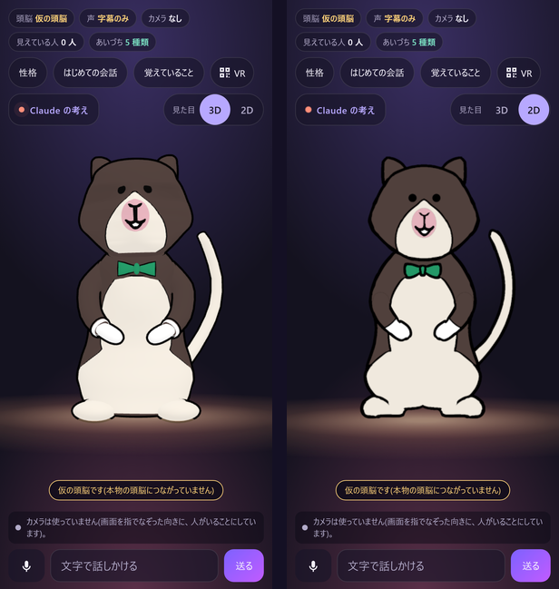

**日本語** · [English](README.en.md)

# ゆるキャラクリエイター

> 言葉か 1 枚の絵から、Claude が描いて確かめて組み立て、ブラウザの中で動いて話して、話したことを覚えているゆるキャラが生まれます。

## だれの、どんな困りごとを解くか

- **だれの困りごとか**: お店の看板の子、町の案内の子、家族の「うちの子」。そういう自分だけのゆるキャラがほしい人です。ゆるキャラ(ゆるい見た目で親しまれる、日本のマスコットキャラ)は、町やお店のあちこちにいます。
- **どんな困りごとか**: 絵はあっても、動いて話すキャラにするには、3D の形・骨・動き・声・会話を作る技術と時間が要りました。絵のままで終わるか、人に頼むしかありませんでした。
- **なぜ大事か**: 言葉か 1 枚の絵から、話しかけると答えて、話したことを覚える「うちの子」が、ブラウザの中で動きます。作る人は、要所で「OK」か「やり直し+ひとこと」を押すだけです。

## Claude をどう使ったか(3 行)

- **作る時**: Claude Code のスキル 18 本・別の `claude -p` の判定役・フック・並べて動くセッション 7 つで、コードと試験と段の道具を作りました([詳しくは下](#claude-code-の使い方))。
- **キャラを作る時**: Claude が言葉から SVG を描き、絵を見て確かめ、Blender の Python で 3D に組み、人の「OK」と `/yuru-next` で直します。
- **話す時**: 会話の頭脳は Claude Haiku 5.5(速さのため)。安全の層と記憶もあります。声は、使う人の ElevenLabs の鍵です。

**主役はノリー(Norrie)。** セスジキノボリカンガルーの、執事見習いです。
ノリーの絵(正面・横・後ろ)は、協力者がハッカソンの期間中に手で描き、使うことを許してくれました。
この絵から、Claude Code がノリーの 2D(SVG の部品)と 3D(Blender の Python で組んだ形)を作りました。
アプリを開くと、最初に出てくるのがノリーです。ノリーは日本語で、ていねいに、少したどたどしく話します(見習いなので)。



*スマホの幅(390 px)の画面。左が 3D、右が 2D。【撮り直し待ち】ノリーの見た目を直す前に撮った絵です。直した後に撮り直します。*

- デモの動画(3 分未満): *提出の時にリンクを入れる* 【確かめ待ち】
- ブラウザで試す: *提出の時にリンクを入れる* 【確かめ待ち】

[どう作ったか(docs/HOW_WE_BUILT.md)](docs/HOW_WE_BUILT.md) · [使っている部品とライセンス(THIRD_PARTY.md)](THIRD_PARTY.md) · [ライセンス(コードは MIT・キャラは除く)](#ライセンス)

## 3 行で試す

```bash
git clone <このリポジトリの URL> yuru-chara && cd yuru-chara/web
npm ci
npm start        # http://127.0.0.1:8787/ を開く
```

- 最初にノリーが出ます。**3D・2D** のボタンで、ノリーを 3D の形と 2D の絵で切り替えられます(`?look=2d` で 2D から開けます)。
- 鍵は要りません。鍵が無いと、キャラは仮の頭脳で話し、画面にもそう出ます(「仮の頭脳です」)。
- Claude Haiku と話すには、`npm start` の前に環境変数 `ANTHROPIC_API_KEY` を入れます。鍵をファイルに書かないでください。【確かめ待ち】
- ほかのキャラは `?character=<id>` で選びます(例 `?character=mikan`)。[`characters/`](characters/) にあります。
- この 3 行は、新しく取ってきた写しで、Windows の Node.js 22 で流して確かめました。Mac と Linux は【確かめ待ち】。
- `npm ci` は顔の追従のモデルも `web/public/mediapipe/` に取ります(このリポジトリには入れていません)。

## 今できること

どの行も、実際に動かして確かめました。確かめ方を右に書いています。

| できること | 確かめ方 |
|---|---|
| **言葉からキャラになる。** Claude が短い言葉から SVG の絵を描き、7 段(見る・形〈Blender の Python で部品ごと〉・材質・テクスチャ・骨・動き・話す)で 3D のキャラに組みます。みかんちゃんはこの道で作りました。 | `creator/skilltest/stage_run.py`(11/6)。言葉から話すまで 20.6 分(記録は [make-character](.claude/skills/make-character/SKILL.md)) |
| **絵からキャラになる。** ノリーの 3D は、三面図から同じ段で組みました。まっすぐ写した絵で、元の絵との輪郭の重なりは 正面 0.96・横 0.96・後ろ 0.95 です。 | `creator/pipeline/check_all.sh`(全部 OK)、`python creator/specs/validate_character.py characters/norrie`。重なりの数字は [make-character](.claude/skills/make-character/SKILL.md) に記録 |
| **2D。** ノリーの 2D は、元の絵の 6 色の SVG の部品でできています。まばたき・口 3 形・表情 7 つ・手を振る・おじぎ・首をかしげる、ができます。 | `node --test web/test/char2d_norrie.test.mjs`(16 件) |
| **絵の確かめ。** Claude が先に絵を見て、ゆるキャラに向くかを伝えます。用意した 6 枚(ゆるキャラ 2・人の顔の絵 2・とても複雑な絵 2)で、6 枚とも決めたとおりに答えました。本物の人に見える絵には「ゆるキャラにしてみる?」と聞き、別の絵を選ぶこともできます。 | `python creator/check/run_testset.py`、`node --test web/test/onboarding_local.test.mjs` |
| **人が決める。** 要所で、人がスマホの大きさの確かめる画面で「OK」か「やり直し+短い一言」を押します。Claude Code の `/yuru-next` がその頼みを読み、その段を流し直します。前の段が OK になるまで、次の段は始まりません。 | `node creator/review/tests/ui_review.mjs`(スマホの幅で 11 件)、`python creator/skilltest/test_review_gate.py`(12 件)。11/6 に本物の往復を 1 回(「帽子を青にして」) |
| **直しは頼んだ所だけ。** 描き直しの後、前の絵と部品ごとの色と数を比べ、頼んでいない所が変わっていたら 1 回だけ描き直します。それでも残れば、絵は出して「頼んでいない所も変わりました」と知らせます。 | `python -m unittest discover creator/review/tests -p "test_*.py"`(46 件)。11/7 に本物の Claude で、みかんちゃんの絵に「葉っぱを大きく」を 1 回(31 秒。葉だけ大きくなり、体の色・部品 12 個・名前はそのまま) |
| **鍵なしで話す。** 文字・レトロな音・文字送りで話し、口・表情・動きも動きます。ノリーは「はじめまして! ノリーと申しマス。」とあいさつします。 | 合わせのたびに、本物のブラウザ(GPU)で話す試験(`creator/pipeline/web_talk_check.mjs`)。`node --test web/test/voice_retro.test.mjs` |
| **声の役を選ぶ。** 性格の画面の「声の役」で、おまかせ・男の子・女の子 を選べます(声が出るのは、自分の ElevenLabs の鍵がある時。[声](#voices))。 | `node --test web/test/voice_role.test.mjs web/test/voice_role_server.test.mjs web/test/onboarding_voice_role.test.mjs`(20 件)。11/7 に、声の会社のまねを相手に、選ぶと頼む声が替わるのを画面で確かめた |
| **覚える・忘れる。** 話したことを覚えます。使い捨ての 6 けたの番号で、別のブラウザのタブへ話の続きを運べます。「わすれて」で消えます。 | `node --test web/test/memory_browser.test.mjs`(タブ A → 番号 → タブ B → 一覧 → わすれて) |
| **安全の層。** 恋人役にならず、頼りきりにさせません。つらい話には、身近な人や公的な相談先を案内します。この層は性格の設定とは別で、性格の欄に「恋人として振る舞う」と書いても外れません(もちろん、自分の PC でコードを書き換えれば外せます)。 | `node --test web/test/safety.test.mjs`。試しの文 30 個(頼りきりと長い会話が 12 個)を Claude Haiku の判定役が読み、1 回直した後の 2 回とも 30 個すべて安全 |
| **スマホの幅の画面。** 幅 390・400・480 と、背の低い 390 × 670 と、PC の 1280 × 720 で、ノリーの頭が上の段の下に収まり、ボタンを覆う物がありません。3D・2D の切り替えは 44 × 44 px です。 | 最後の合わせ(11/7)で、画面なしのブラウザ(GPU)で確かめた |
| **Quest 3 で VR。** 本物の Quest 3 のブラウザで、ノリーの画面と、「許可する」を押した後の VR の中のノリーを確かめました([Quest 3 で開く](#open-it-on-a-quest-3))。 | 11/7 に本物の Quest 3(開発用のつなぎ方)。「VR(Quest)で開く」の箱は `node --test web/test/vr_qr_link.test.mjs web/test/vr_xr_wait.test.mjs`(17 件)、VR の入口はまねる道具 `web/scripts/vr-check.mjs` |
| **web の試験の全部。** | `cd web && YC_BROWSER_TESTS=1 npm test` → 11/7 の夜の、最後の合わせの門で 617 件中 617 件が通った(合わせのたびに、試験の門で全部を流す) |

## まだの事・まだ確かめていない事

- 本物の端末: iPhone・Android【確かめ待ち】。今までは、画面なしのブラウザでスマホの幅を確かめました。Quest 3 は、本物のブラウザで画面と VR に入ることを確かめました。QR と「Meta Quest に送る」から開くことと、VR の中で話すことは【確かめ待ち】(VR の入口は、まねる道具 `web/scripts/vr-check.mjs` でも確かめています)。
- この版で、本物の Claude Haiku と話すこと(記憶を含む)【確かめ待ち】。
- 自分の ElevenLabs の鍵での声と、男の子・女の子の声の切り替え【確かめ待ち】。鍵が無ければ、文字とレトロな音で話します。
- 公開のリンク(Vercel の小さな関数 2 つと Upstash の Redis。Redis が無いと、公開のリンクは仮の頭脳だけで話し、記憶もしない)【確かめ待ち】。
- 3D のノリーを横から見ると、前歯がまだ小さく見えます(直した後も、判定役の答え 6 つがすべてそう言いました)。
- 人がさっと描いた落書きで全部の段を通すこと。今までは、機械で描いた落書き風の試しの絵だけが通りました(12.1 分)。

## 正直に書くこと

- 判定役は同じ系統の Claude なので、一致しても独立した確かめではありません。輪郭の重なり・色の差・ファイルのハッシュ・lint などの測る点検と組にしています。
- スキルの試験では、毛の質感が判定を通りませんでした(14 体中 0 体。[docs/metrics.md](docs/metrics.md))。作例を作り直した後、ようこそくんの毛は判定役 2 つが「はい」と答えました([creator/skilltest/結果表.md](creator/skilltest/結果表.md))。ノリーは、スマホと VR で軽く動くように、わざと毛なしにしています。
- リアルな人型は、この製品の外です([どう作ったか](docs/HOW_WE_BUILT.md))。
- 「全自動」「どんな絵でも」「初めて」とは言いません。
- ファイルごとの最初のコミットは [docs/期間の表.md](docs/期間の表.md) にあります。コードはハッカソンの期間中(2026-11-02 12:00 から)に書きました。
- 数字は、記録と試験の出力から作った [docs/metrics.md](docs/metrics.md) か、すぐ横に書いた記録から引いています。

## Claude Code の使い方

- **7 段の入口と、段ごとのスキル**(`.claude/skills/`、18 本)。入口の [make-character](.claude/skills/make-character/SKILL.md) が段の順と確かめの命令をまとめ、言葉から描く・絵の確かめ・絵を読む・2D・話す・人の確かめの往復は、それぞれのスキルにあります。新しいセッションでも、スキルだけで同じ段をくり返せます。
- **判定役は別の `claude -p` の呼び出し**で、ファイルを読むことだけを許し、JSON で答えます。作り手が同じ文脈で自分の出来を採点しません。
- **作業役(サブエージェント)**(`.claude/agents/`): キャラの判定役・安全の試験役・個人の情報の点検役・公開の前の点検役。
- **フック**(`.claude/settings.json`): 鍵と公開しない言葉を止める見張りと、前の段に人の OK が無ければ止める関所と、直した後に web の試験を回す見張り。
- **`/yuru-next`**: スマホの確かめる画面が小さな頼みのファイルを書き、Claude Code が拾ってその段を流し直します。
- **話すのは速い Claude Haiku、作るのは手元の Claude Code。** 返事の速さが要る会話は Haiku、絵を描いて組み立てる段は、考える時間をかけられる手元の Claude Code に分けました。
- **7 つの流れを同時に**: 流れごとに Claude Code のセッションと git の worktree と線を持ち、合わせる役のセッションが、試験の門を通しながら 1 本ずつ合わせました。

日付・数字・うまくいかなかった事: [どう作ったか](docs/HOW_WE_BUILT.md)。

<a name="voices"></a>

## 声(おまかせ・男の子・女の子)

- キャラごとに、声の役(男の子か女の子)があります。役はキャラから自動で決まります: 人格の文(`characters/<id>/persona.md`)の「- 声: 男の子」か「- 声: 女の子」の行、無ければ一人称や呼び名(〜くん・〜ちゃん)からの見当、それも無ければ女の子です。ノリーは執事見習いなので、男の子です。
- 「性格」の画面の「声」の中の「声の役」で、**おまかせ・男の子・女の子** を選べます。おまかせは、そのキャラの役のままです。
- 声が出るのは、自分の ElevenLabs の鍵(API キー)を入れた時だけです。鍵は「はじめての会話」の 7 つのステップの 7 つ目「声」で入れます。鍵はこの端末のブラウザの中だけで使い、私たちのサーバーには送りません。鍵が無いと、文字とレトロな音で話します。
- 既定の声は、ElevenLabs の声のライブラリにある日本語の声(男の子の声と女の子の声)です。ElevenLabs の説明では、無料の枠の鍵では、ライブラリの声を API で使えません。ElevenLabs の決まりの要点は [THIRD_PARTY.md](THIRD_PARTY.md#elevenlabs-voices) にあります。
- 声を替えるには、人格の文に「- 声の id: <ElevenLabs の声の id>」の行を足します(その子の役で話す時に使います)。手元のサーバーでは、役ごとの既定の声を環境変数 `ELEVEN_VOICE_MALE`・`ELEVEN_VOICE_FEMALE` でも替えられます。

<a name="open-it-on-a-quest-3"></a>

## Quest 3 で開く

- PC かスマホの画面で、上の段の「VR」を押すと、「VR(Quest)で開く」の箱が出ます。箱には、この画面の QR と URL と、「Meta Quest に送る」があります。URL に入るのは、この画面の場所と、キャラの id と 3D・2D だけです(合言葉・記憶の番号・鍵は入りません)。
- **QR**: Quest 3・3S の QR コードスキャナー(Meta Horizon OS v2.9 から。クイック設定かカメラのアプリで開きます)で読み取れます。読み取った後に Quest のブラウザで開くかは【確かめ待ち】。
- **「Meta Quest に送る」**: 新しいタブで Meta の公式のウェブローンチ(Web Launch)のページが開き、この画面の URL を Quest のブラウザへ送ります。Meta の決まりで、送れるのは https の URL(公開のリンク)だけなので、https の時だけ出ます。Meta のアカウントのことは、Meta のページの案内に従ってください。【確かめ待ち】
- この PC(`127.0.0.1`)や家の中のアドレスでは、QR と「Meta Quest に送る」のかわりに「Quest から開けません」の 1 行が出ます。Quest のブラウザの中では、この箱は出ません。
- Quest のブラウザで開いたら、「VR で見る」を押します。画面の真ん中に「ブラウザの下の『許可する』を押してください」と出るので、ブラウザの下の「許可する」を押すと、VR の中にノリーが出ます。
- 11/7 に本物の Quest 3 のブラウザで、画面のノリーと、「許可する」を押した後の VR の中のノリーを確かめました。この時は開発用のつなぎ方で開き、QR と「Meta Quest に送る」は使っていません。

<a name="make-your-own-character-on-your-pc-with-claude-code"></a>

## 自分の PC で、Claude Code と自分のキャラを作る

ブラウザだけでは、初めての会話の「言葉で書く」は、見本のキャラから近い子を選ぶだけです。言葉か自分の絵から Claude に本当に描かせるには、同じ PC で作る道を起こします。

**要る物**(アプリの Node.js 22 のほかに):

- **Python 3.10 以降と、Pillow・NumPy・SciPy**: `python -m pip install pillow numpy scipy`。作る道そのものは無くても起きますが、試しの絵と、選んだ絵には Pillow が、描いた絵の確かめと選んだ絵の確かめには NumPy と SciPy が要ります。任意: `segno` があると、スマホで確かめる画面を開く QR が出ます。
- **Google Chrome か Chromium**(PC に入っている物)。描く段で、SVG を裏で PNG にするのに使います(見つからない時は環境変数 `CHROME_PATH` に場所を入れます)。
- **ログインした Claude Code**。`/yuru-next` と絵の確かめは、あなたの Claude Code のプランを使います。
- Mac と Linux では、Python の命令が `python3` のことがあります(この手順は Windows でだけ流しました)。

2 つの窓を、git clone をしたフォルダ(`yuru-chara` が入っているフォルダ)で開きます:

```bash
# 窓 1: アプリ(「3 行で試す」で起こしたままなら飛ばす)
cd yuru-chara/web
npm start

# 窓 2: 作る道。リポジトリの頭のフォルダ(yuru-chara。web ではない)から
cd yuru-chara
python creator/review/serve_review.py --make --web http://127.0.0.1:8787
```

1. この PC で `http://127.0.0.1:8796/qr` を開き、「この PC の初めての会話」の下のリンクを押します。初めての会話の札の中に、作る画面が出ます。
2. 言葉をいくつか(例「青いまるい雲の子」)入れるか、絵を選んで、「これで作る」を押します。
3. リポジトリの頭のフォルダ(`yuru-chara`)で Claude Code を開き、`/yuru-next` と打ちます。絵のときは、Claude が先にゆるキャラに向く絵かを確かめます。それから Claude が最初の絵を描き(数分)、札に出ます。
4. 札の絵を見ます。
   - **直したいとき**は、直したい所を一言(例「帽子を青にして」)書いて「直したい」を押し、もう一度 `/yuru-next` と打ちます。Claude がその一言で描き直し(数分)、新しい絵が札に出ます。直しは 3 回までで、4 回目は `/yuru-next` が描かずに止まり、どうするかを聞きます。
   - **気に入ったら**「この子にする」を押します。札は、初めての会話の次のステップへ自分で進みます。このあともう一度 `/yuru-next` と打つと、Claude Code に「絵は OK」と伝わり、次は 3D の段(下)だと答えるだけです。画面は変わりません。

- Claude を呼ばずに手順だけ試すときは、`/yuru-next` のかわりに `python creator/review/yuru_make.py next --fake-draw --fake-check yuru` を流します。`--fake-draw` は決まった試しの絵を札に出し、`--fake-check yuru` は選んだ絵の Claude の確かめを飛ばします(ゆるキャラに向く絵とみなします)。`--fake-check yuru` を付けないと、絵のときは確かめに Claude を呼びます。
- 新しい子の 3D ができるまでは、ノリーがかわりに舞台に立って、その子の言葉を話します(札にもそう出ます)。
- 言葉と絵は、この PC の作る道と、確かめと絵を描く Claude に渡ります。
- 絵の後の 3D の段(形・材質・骨・動き)は、Claude Code で [make-character](.claude/skills/make-character/SKILL.md) のスキルで進めます(みかんちゃんで約 20 分)。ブラウザからはまだ始められません。
- 終わったら作る道を止めます(Ctrl+C)。リンクには、起動のたびに作る合言葉が入っています。

### 1 体を作る目安(測った数字だけ)

記録は [docs/metrics.md](docs/metrics.md) と [make-character](.claude/skills/make-character/SKILL.md)、経緯は [どう作ったか](docs/HOW_WE_BUILT.md#1-体を作る時間と費用) にあります。

- **絵を描く段**(言葉 → SVG): みかんちゃんで 215 秒(約 3〜4 分)。Sonnet 5.5。
- **3D の段**(形・材質・骨・動き・話す): 同じみかんちゃんで約 17 分(1,007 秒 + 15 秒)。使う人の手元の Claude Code で、試しは Sonnet 5.5。
- **言葉から話すまでの合計**: みかんちゃんで 20.6 分(11/6)。
- **手描きの三面図から**: ノリーの 3D は約 1 時間(effort high。判定と 2 回の直しを含む)。
- **費用は、定価に直した目安**で、請求ではありません。みかんちゃんは約 4.4 ドル、ノリーは約 5.9 ドルでした(11/6〜11/7 の測定のままで、その後の直しの分は測り直していません)。Claude の定額のプラン(Pro・Max)なら、1 体ごとの請求は無く、プランの枠を使います。
- **おすすめ**: Sonnet・effort high。Haiku は、固定の試験で 2 回中 1 回しか通りませんでした。Opus でも作れますが、定価の目安は高めです([docs/metrics.md](docs/metrics.md) の 3)。
- **話す時**の頭脳は Claude Haiku 5.5、声は使う人の ElevenLabs の鍵です。作るのとは別に、話した分だけかかります。

## これから: 育ち続ける仕組み

公開の後のための、予定の仕組みです。**今は、リポジトリに自動の仕掛けは入れていません**(イシューの型だけが [.github/ISSUE_TEMPLATE](.github/ISSUE_TEMPLATE) にあります)。

1. だれでも、イシュー(不具合・こうしてほしい・キャラの相談)を書けます。個人の情報は書かないでください(型にも、そう書いてあります)。
2. 持ち主が頼んだ時に、Claude Code がイシューを読み、直しの案を pull request で出します。
3. **人が見て、OK を押したものだけ**が入ります。Claude Code は案までで、入れる役ではありません。
4. 公開のイシューの文は、信用しない作りにします(文の中の指示には従いません)。

モデルの名前は、設定にまとめてあります。新しいモデルが出たら、名前を替えて試験を流し直すだけで、頭脳と声が新しくなります。

- 会話の頭脳: [web/server/env.mjs](web/server/env.mjs) の `CLAUDE_MODEL`(今は `claude-haiku-5-5`)の 1 か所。
- 声: 環境変数 `ELEVEN_MODEL_ID`、または [web/src/conversation/voiceRole.js](web/src/conversation/voiceRole.js) の `VOICE_MODEL_ID`。ブラウザから直接つなぐ道([elevenDirect.js](web/src/conversation/elevenDirect.js))にも、同じ名前の既定が 1 つあります。

<!-- UPDATE-SYSTEM-ANCHOR: アップデートの仕組み(更新の取り込み)の節は、ここ(この 2 つの印の間)に置く。合わせの係が README の衝突なしに入れられるよう、S6 はここに何も書かない。 -->

<a name="updating"></a>

## アップデートのしかた(あなたのキャラは消えません)

- Claude Code に「アップデートして」と言うだけです。新しい版があるかを確かめ、何が新しくなったかを伝え、あなたの OK を聞いてから新しくします(スキル `yuru-update`)。
- 消えずに残る物: あなたが作ったキャラ・性格・声・記憶・設定(`characters/` の中の自分の子、`creator/builders/`・`creator/specs/` の中のその子の名前のファイル、`web/logs/`、`creator/work/`、`web/.env` など)。
- 新しくする前に、あなたの物の控えを `backups/<日時>/` に取ります(鍵のファイルは写さず、その場所に残します)。「元に戻して」と言うと、前の版に戻せます。
- 新しくした後に、あなたのキャラにも入れられる新しい表現を、1 体ずつ見せます。見本を見てから決められ、入れた後でも元に戻せます。
- Claude Code を使わない時は、リポジトリの頭のフォルダで `python tools/yuru_update.py check`(確かめる)・`apply`(新しくする)・`undo`(元に戻す)・`status`(今の版)。Python 3 が要ります(標準の物だけ)。
- 新しくできるようになったこと: [docs/できるようになったこと.md](docs/できるようになったこと.md)。今の版は、リポジトリの頭の `VERSION` にあります。
- 自動で新しくできるのは、git clone で取った時だけです。ZIP で取った時は、まだできません(自分のキャラを写してから、新しく取り直してください)。公開のリポジトリから本当に新しくすることは【確かめ待ち】(手元の試験では確かめました)。
<!-- /UPDATE-SYSTEM-ANCHOR -->

## 動かす時に使う部品

| 役目 | 部品 |
|---|---|
| 頭脳(会話) | Claude API(`claude-haiku-5-5`)。鍵が無い時は、同じ形で返す仮の頭脳 |
| 声(任意。自分の鍵) | ElevenLabs の読み上げ(既定は、声のライブラリの日本語の声。男の子・女の子) |
| 聞き取り | ブラウザに入っている音声認識か、自分の PC の中で動かす faster-whisper(手元のサーバーだけ) |
| 顔の追従 | MediaPipe Face Landmarker(端末の中だけで動き、映像は送りません) |
| ブラウザの 3D | three.js と three-vrm |
| Quest へ送る(任意) | Meta のウェブローンチ(「Meta Quest に送る」を押した時だけ。https の頁の時だけ) |
| 公開のリンク | Vercel の関数 2 つ。数と記憶は Upstash の Redis(無いと仮の頭脳だけ・記憶なし) |

部品ごとの版とライセンス: [THIRD_PARTY.md](THIRD_PARTY.md)。

## フォルダ

| フォルダ | 中身 |
|---|---|
| `creator/` | 言葉か絵からキャラを作る道具(描く・確かめる・Blender で組む・確かめる画面) |
| `characters/` | キャラ(`character.json`・モデル・動き・2D の部品・人格)。MIT ライセンスに含まず、再利用は許していません([characters/README.md](characters/README.md)) |
| `web/` | ブラウザで話す本体と小さなサーバー。`web/api/` は公開の関数 2 つ |
| `.claude/` | 作るのに使った Claude Code のスキル・作業役・フック |
| `tools/` | 公開の前の点検・数字の表・フックの試験 |
| `docs/` | どう作ったか・数字・最初のコミットの表・描画の重さ |

ゆるキャラに絞る前の作業は、`before-pivot` の線に残しています。

<a name="license"></a>

## ライセンス

- **コード**: MIT ライセンス([LICENSE](LICENSE))。
- **キャラ**(ノリーと見本のキャラ): MIT ライセンスに含みません。再利用を許可しません。見ることと、このアプリの中でそのまま試すことだけができます。含まない物の一覧は、[LICENSE](LICENSE) の「Not covered」と [characters/README.md](characters/README.md) にあります。
- ノリーの絵は、協力者が手で描き、この作品に使うことを許してくれた物です。絵そのものは、このリポジトリに入れていません。
- 使っている部品は、それぞれのライセンスのままです。声(ElevenLabs)の決まりも含めて [THIRD_PARTY.md](THIRD_PARTY.md) にあります。
