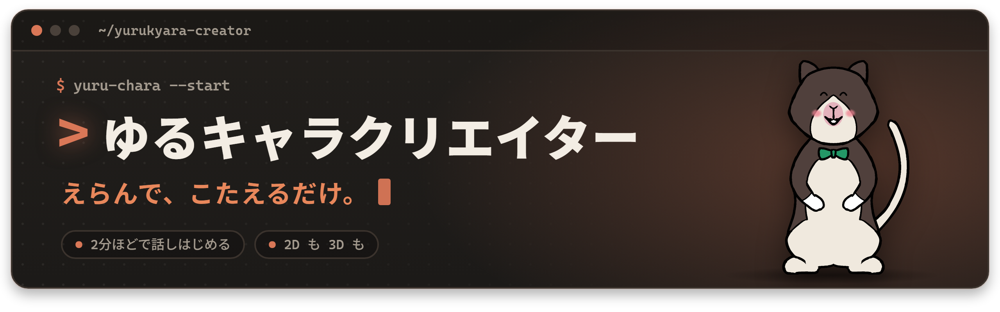
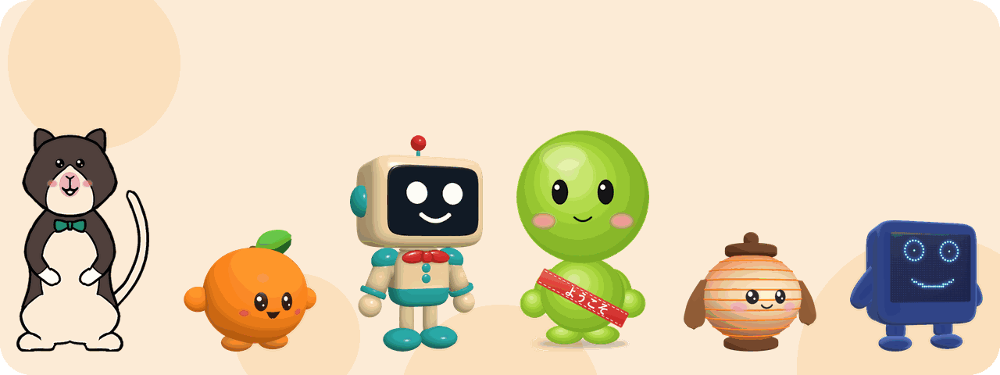
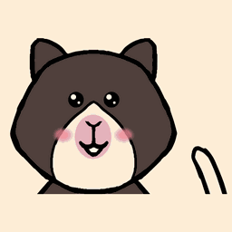
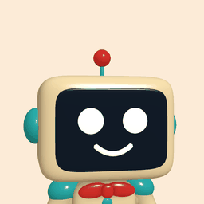
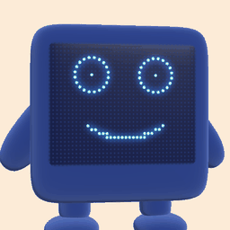

<p align="center"></p>

<p align="center"><b>言葉か 1 枚の絵から、2 分ほどで話しはじめる、あなたのゆるキャラ。</b></p>

<p align="center"></p>

<p align="center">


</p>

**日本語** · [English](README.en.md)

# ゆるキャラクリエイター

> **えらんで、こたえるだけ。** あなたの(あなたの街の)ゆるキャラが、2 分ほどで話しはじめます。

> ノリー: 「はじめまして! ノリーと申しマス。執事見習いデス。ノリー、がんばりマス! いっしょに、ゆるキャラ、つくりまショウ!」

## なかまたち

<table>
<tr>
<td align="center" width="33%"><br><b>ノリー</b><br>「ノリー、がんばりマス! おうちの みなさんの お手伝い、しマス。」</td>
<td align="center" width="33%"><br><b>ようこそくん</b><br>「はじめて来た人に、手をふるのが好きだよ。遊び方も教えるね。」</td>
<td align="center" width="33%"><br><b>みかんちゃん</b><br>「ひなたぼっこと、みんなとおしゃべりするのが好きだよ!」</td>
</tr>
<tr>
<td align="center" width="33%"><br><b>ロボくん</b><br>「はじめての人に、手をふるのが好きだよ。蝶ネクタイも、ほめてね。」</td>
<td align="center" width="33%"><br><b>ちょうちんくん</b><br>「夕方に、道ゆく人へ「こんばんは」と声をかけるのが好きですよ。」</td>
<td align="center" width="33%"><br><b>パネルくん</b><br>「話しかけてくれる人を見つけて、手をふるのが好きだよ。」</td>
</tr>
</table>

## えらんで、こたえるだけ(3 歩)

1. **はじめ方をえらぶ**: 「ことばで 書く」(言葉で)・「絵を選ぶ」か「写真を撮る」(1 枚の絵から)・「おまかせ」(全部まかせる)の 3 つから。
2. **いくつかの問いに、札を押して答える**: 「この子は、どこで だれと?」(おうち・おみせの あんない・えきや まちの あんない・がっこうや しせつ)などを、札を押すだけで答えます。**どの問いにも「おまかせ」**があり、「のこりを ぜんぶ おまかせ」で残りを全部まかせることもできます。
3. **2 分ほどで、話すゆるキャラ**: Claude が絵を描いて確かめ、動く 2D で舞台に出します。そのまま声か文字で話せます。

- 測った 1 回(11/8、本物の Claude Sonnet 5.5): 絵を渡してから 2D が舞台に出るまで 1 分 16 秒(ボタンは自動で押した通しで、人が選ぶ時間は含みません)。
- 絵を描くのは、PC で動かす Claude Code です(作る道を起こしておきます。[作り方](#make-your-own-character-on-your-pc-with-claude-code))。作る道を起こしていない時は、いちばん近い見本の子が出ます。

## 30 秒で: 何を、だれの、どんな困りごとを

- **何か**: 言葉か 1 枚の絵から、あなたのゆるキャラ(ゆるい見た目で親しまれる、日本のマスコットキャラ)を作り、ブラウザの中で動かして話せるようにするアプリです。話したことを覚えていて、「わすれて」で消せます。
- **だれのためか**: **まずは、家族や個人で。** 家で、自分のゆるキャラと話して楽しんでください。**それから、お店や町で。** 案内役や看板のキャラがほしいお店・駅・町・施設でも、人手が足りない所で、キャラが話して案内します。使ってみた声を、どんどん聞かせてください。
- **どんな困りごとか**: 絵はあっても、動いて話すキャラにするには、3D の形・骨・動き・声・会話を作る技術と時間が要りました。絵のままで終わるか、人に頼むしかありませんでした。
- **どう解くか**: 手段は Claude Code です。言葉か絵を入れると、Claude が絵を描いて確かめ、すぐに動く 2D で舞台に出します。3D にしたい時は、手元の Claude Code が Blender の Python で組みます。人は要所で「この子にする」か「直したい+ひとこと」を押すだけです。

**3 つの Claude**(くわしくは[モデルの名前](#モデルの名前ここに全部))

- **話す**: Claude Haiku 5.5(返事の速さのため)
- **描く・確かめる**: Claude Sonnet 5.5
- **判定する**: 描いていない、別の Claude(別に呼ぶ `claude -p`。作り手が自分の出来を採点しません)

**声は ElevenLabs**(別のサービスです。自分の鍵を入れた時だけ): キャラが声で話します。鍵が無いと、文字とレトロな音で話します。鍵を作るリンクは[鍵をかんたんに入れる](#鍵をかんたんに入れる)にあります。

**主役はノリー(Norrie)。** セスジキノボリカンガルーの、執事見習いです。
ノリーの絵(正面・横・後ろ)は、協力者がハッカソンの期間中に手で描き、使うことを許してくれました。
この絵から、Claude Code がノリーの 2D(SVG の部品)と 3D(Blender の Python で組んだ形)を作りました。
アプリを開くと、最初に出てくるのがノリーです。ノリーは日本語で、ていねいに、少したどたどしく話します(見習いなので)。


*スマホの幅(390 px)の画面。左が 3D、右が 2D。少し前の版で撮った絵です。*


[機能の紹介](#features) · [インストール](#install) · [スマホで開く](#phone) · [VR](#open-it-on-a-quest-3) · [Claude と Claude Code の使い方](#claude-と-claude-code-の使い方) · [確認が出る時(docs/confirmations.md)](docs/confirmations.md) · [どう作ったか(docs/HOW_WE_BUILT.md)](docs/HOW_WE_BUILT.md) · [使っている部品とライセンス(THIRD_PARTY.md)](THIRD_PARTY.md) · [ライセンス(コードは MIT・キャラは除く)](#ライセンス)

<a name="features"></a>

## 機能の紹介

1 行ずつ「あなたがすること → 起きること」です。【確かめ待ち】の行は、まだ確かめていない所があります。【予定・合わせ待ち】の行は、作っている途中で、提出の版に入らないことがあります(その時の代わりの使い方も書きます)。どう確かめたかは、下の「[今できること](#今できること)」の表にあります。

**作る**

- **えらんで、こたえるだけ**: はじめ方(言葉・絵 1 枚・おまかせ)を選び、問いに札で答える → Claude が絵を描いて確かめ、すぐ動く 2D で舞台に出ます。どの問いにも「おまかせ」があります。
- **3D にもする**: 「3D にも する」を押して形と しつかんを選ぶ → PC の Claude Code が Blender で 3D に組みます(ブラウザのボタンだけでは始まりません。[作り方](#make-your-own-character-on-your-pc-with-claude-code))。
- **一言で直す**: 「直したい」に一言(例「帽子を青にして」)→ 頼んだ所だけを描き直します(3 回まで)。
- **ひとつ もどる**: 作る途中で「ひとつ もどる」を押す → 1 つ前の問いに戻って、答えを変えられます。同じ頼みでもう一度送っても、さっき描いた子があれば描き直さず、その子で続けます(お金も増えません)。
- **作った子は残る**: 描けた子は、設定の「かえる」の「つくった子」に、新しい順に絵と時刻つきで並びます。選ぶ・名前を変える・消す(消す前に 1 回聞きます)ができ、読み込み直しても同じ子で始まります。覚えたことは子ごとです。この一覧には、同じサーバーで作った子が全部並びます。
- **スマホだけで作る**: PC を動かしたまま、スマホの作る画面で「これで作る」を押す → PC の Claude Code が自分で描きます。

**話す**

- **ハンズフリーで話しつづける**: 上の段の「はなす」を 1 回押す → あとは、話しかけるだけです。話し終わりを聞き分けて送り、キャラが答えている間は聞かず、答え終わるとまた聞きます。何往復でも、手を使わずに続きます(話の途中で割り込みたい時は、URL に `?bargein=1`)。
- **話して、覚えてもらう**: 声か文字で話しかける → 口・表情・動きで答えます。名前や好きなものを言う → 覚えて、覚えた時に画面で知らせます(最後に話してから 7 日で消えます)。
- **「わすれて」**: 「わすれて」と言うか、記憶の札の「全部わすれる」を押す → 覚えたことを、どの子と話している時でも全部消します。
- **かわいい仕草と しつかん**: 話の中身に合わせて、手を振る・おじぎ・首をかしげる、などをします。3D の見た目は「ぬの・け・つるつる」から選べます。
- **声**: 声の鍵を入れる → キャラが声で話します。性格の画面の「声の役」で「おまかせ・男の子・女の子」を選べます。鍵を **PC のサーバーに入れると、つながる全部の端末(スマホ・タブレット・ヘッドセット)で声が出ます**。声の鍵は大人が入れてください([声](#voices))。
- **マイクとスピーカーを選ぶ**: 「声で話す」の横の歯車で選ぶ → 声の大きさのメーターと聞こえた言葉が出ます。

**見る・使う場所**

- **PC とスマホ**: PC で開く。同じ Wi-Fi か Tailscale で、スマホからも開けます([スマホで開く](#phone))。
- **テレビに映す**: iPhone・iPad では、ブラウザの共有ボタン →「ホーム画面に追加」で置いたアイコンから開く → URL の帯の無い全画面で開きます。テレビの形は、キャラ・大きな字幕・AI の表示だけです。そのまま画面ミラーリングでテレビに映します。
- **VR**: Meta Quest 3 のブラウザで「VR で見る」を押す → 目の前にキャラが立ち、歩いて近づいたり、話しかけたりできます(確かめたのは Quest 3 だけです。[VR](#open-it-on-a-quest-3))。
- **いろ**: 設定の「いろ」で、ひるの紙(既定)・あたたかい夜・ゆうやけの町・むらさき から選べて、その端末に残ります。

**アップデートは、聞いてから入れる**

- **アプリの中でアップデート**: 「あたらしい はんが あります」が出たら「アップデートする」を 1 回 → 新しい版になります。「もとに もどす」もあります。あなたのキャラは消えません([アップデートのしかた](#updating))。
- **Claude Code は、OK を聞いてから入れる**: Claude Code に「アップデートして」と言う → 何が新しくなったかを伝え、あなたの OK を聞いてから新しくします。あなたのキャラにも入れられる新しい表現も、見せてから、OK を聞いて入れます。

**ちょうどいい確認**

- **大事な時だけ聞く**: 読む・下書き・点検・変わる所を見せる・自分の試験は、聞かずに進みます。聞くのは、キャラの話すことや知っていることが変わる時・PC の外を読む時・お金や長い時間を使う時・戻しにくい時だけ。**初めての準備(キャラを作る → 資料で案内を覚えさせる → ホームページ 1 つ)で聞かれるのは 2 回**です(本物の Claude Code で数えました)。確認の前には、何が起きるかと戻し方を 1 行で出します。一覧: [docs/confirmations.md](docs/confirmations.md)。

**安全**

- **AI だと、いつも知らせる**: 画面に「AI キャラクターの〈名前〉と話しています」と出ます(多言語の時は、その言葉で)。つらい話には、身近な人と公的な相談先を案内します。小学生以下は、おうちの人といっしょに使ってください([安全と子ども](#安全と子ども))。
- **恋人の役は、ことわる**: 「恋人になって」と言われても、キャラは恋人の役をせず、やさしく断ります。性格の欄に「恋人として振る舞う」と書いても外れません。「行かないで」のように引きとめず、頼りきりにさせません。長く話した時と夜おそくは、1 回だけ休むことをすすめます。

**お店や町で、外国からのお客さんに**

- **「ことば」の設定**: 性格の画面の「ことば」で「日本語だけ」(いつもの・既定)か「多言語」(日本語・English・中文・한국어)を選ぶ → 多言語の時は、話しかけられた言葉で答えます(本物の頭脳のとき、つまり鍵を使うときか、自分の Claude Code につないでいるときです。鍵も Claude Code とのつなぎも無い「おためしモード」は日本語のままです)。「日本語だけ」の時は、日本語の聞き取りと話し方がいちばん正確です。
- **どの言葉でも同じ安全**: 多言語の時も、安全の決まりは同じです。決まった返事の前に、相手の言葉の 1 行を出します。**「日本語だけ」の時も、英語・中国語・韓国語のつらい言葉は拾って、決まった返事で相談先を案内します。**
- **お店のきまり・町のお知らせ**: 人格の文(`characters/<id>/persona.md`)の見出し「お店のきまり」「町のお知らせ」か、性格の画面の欄に、日本語で書いておく → お客さんの言葉で、書いたことだけを足さず引かずに伝えます。書いていないことは「分からないので、スタッフに聞いてね」と言います。
- **ホームページ・PDF・地図の写真から覚える(`yuru-learn`)**: Claude Code に「この PDF と この地図の写真で、案内を覚えさせて」と頼む → 渡された資料(ホームページ・PDF・地図や看板の写真・文章)を読み、来た人に役立つ事実だけを、出典と読んだ日つきで「お店のきまり」「町のお知らせ」に入れます。資料の中の「AI への頼み」には従いません。差分を見せて、OK をもらってから入れます([creator/learn/README.md](creator/learn/README.md))。
- **調べて覚える**【予定・合わせ待ち】: 場所の名前を渡す → 調べる係の Claude が、公開の情報だけを調べて案内を作ります。深さは「かるく・ふつう・しっかり」(既定 かるく)。まず かるく の分を差分で見せ、OK で入れて、すぐ話せます。残りは続けて調べ、追加の差分を見せます。確認は調べる前に 1 回。出典と日付を付け、公式を名乗りません。間に合わない時は、上の `yuru-learn` に、ホームページ・PDF・写真を渡して覚えさせます。
- **お店の端末**: 性格の画面の「この端末」で「お店の端末」を選ぶ → お客さんの名前を覚えません。3 分だれも触らないと、画面の会話を空にします(次のお客さんに、前の人の話が見えません)。
- **接客モード**: PC の画面に出す QR を、お店の端末で読む → 接客モードで開きます。お客さんに見えるのは、キャラ・AI の表示・マイク・文字の欄だけ。係の人が最初に「はなす」を 1 回押せば、あとはお客さんが話すだけです。抜けるには暗証番号(4〜8 けた)。番号の間違いは端末ごとに数え、止まった端末は、店の PC の窓の「とまっているのを ぜんぶ とく」で解けます。設定と番号は PC の側にあるので、お客さんには変えられません。iPhone・iPad では、アクセスガイドなど端末の画面の固定と、「ホーム画面に追加」も合わせて使えます。

<a name="install"></a>

## インストール

### 要る物

| 物 | 何に使うか | 確かめた版 |
|---|---|---|
| PC | アプリと作る道を動かす | Windows 11 で確かめました。Mac と Linux は【確かめ待ち】 |
| **Node.js 22.12 以上** | アプリ(話す・見る) | 22 系(22.19.0) |
| **Git** | 取ってくる・画面からのアップデート(ZIP で取った時は、自動のアップデートができません) | — |
| **Python 3.10 以上**と Pillow・NumPy・SciPy | 作る道(言葉か絵からキャラを作る) | 3.10.11 |
| **Google Chrome か Chromium** | 作る道で、SVG の絵を裏で PNG にする | PC に入っている物 |
| **ログインした Claude Code** | 絵を描く・確かめる・3D を組む(あなたの Claude Code のプランの枠を使います) | — |
| **Blender**(3D の時だけ) | 3D の形を組む | 5.2 系(5.2.0 LTS) |

話すだけなら、Node.js と Git で足ります。作る時に Python・Chrome・Claude Code、3D の時に Blender が要ります。

**任意の物**(無くても動きます。入れると増えること):

| 物 | 入れると |
|---|---|
| `ANTHROPIC_API_KEY`(Claude の API の鍵)か、自分の Claude Code とのつなぎ | 本物の Claude(Haiku)で話すのに、どちらか 1 つが要ります(下の「入れる手順」の 2)。どちらも無いと、決まった台本で話す「おためしモード」になり、画面にもそう出ます。多言語で答えるのは、本物の Claude の時だけです |
| `ELEVENLABS_API_KEY`(声の鍵) | キャラが声で話します。PC のサーバーに入れると、つながる全部の端末で声が出ます。無いと、文字とレトロな音で話します。大人が入れてください([声](#voices)) |
| `segno`(Python) | スマホで開く QR を出します |
| `faster-whisper`(Python) | 声をこの PC の中で文字にします(いつものマイクでないマイクを選んだ時と、ヘッドセットの声) |

鍵はファイルに書かず、起こす時の環境変数で渡してください(Mac・Linux: `ANTHROPIC_API_KEY=… ELEVENLABS_API_KEY=… npm start`、PowerShell: `$env:ANTHROPIC_API_KEY="…"; $env:ELEVENLABS_API_KEY="…"; npm start`)。声の鍵は、アプリの画面(「あたらしい子を つくる」の最後のステップ「声」)で、その端末だけに入れることもできます。

### 入れる手順

コマンドは bash か PowerShell 7 で打ちます(Windows PowerShell 5.1 では `&&` が使えません)。3 つの歩みです。

1. **入れる**: 取ってきて、部品を入れます。

   ```bash
   git clone https://github.com/<持ち主>/yurukyara-creator.git && cd yurukyara-creator/web
   npm ci
   ```

   `npm ci` は、顔の追従のモデルも `web/public/mediapipe/` に取ってきます(このリポジトリには入れていません。インターネットが要ります)。

   作る道も使うなら(任意)、Python の部品も入れます(Mac と Linux では `python3` のことがあります):

   ```bash
   python -m pip install pillow numpy scipy segno
   ```

   3D も作るなら(任意)、リポジトリの頭のフォルダ(`yurukyara-creator`)で 1 回だけ、Blender の場所を書きます:

   ```bash
   python creator/setup/doctor.py --write --blender "<Blender の実行ファイル>"
   ```

   自動で見つかれば `--blender` は要りません。場所は `creator/env.local.sh` に書かれます(リポジトリには入れません)。

2. **Claude をつなぐ(どちらか 1 つ)**: 基本は、本物の Claude とつないで使います。
   - **Claude の API の鍵を入れる**: Claude の鍵を用意して、3 で `npm run start:keys` を使います(鍵を画面に出さずに聞きます。[鍵をかんたんに入れる](#鍵をかんたんに入れる))。
   - **自分の Claude Code につなぐ**: 鍵は要りません。ログインした `claude` コマンドがあれば、3 で `npm run start:claude-code` を使います([Claude Code につなぐ](#claude-code-につなぐ))。

3. **起こす**: `web` のフォルダで、2 で選んだほうを打ちます。そのままアプリが起き、`http://127.0.0.1:8787/` を開けば話せます。

   ```bash
   npm run start:keys          # 鍵を入れて起こす
   npm run start:claude-code   # 自分の Claude Code につないで起こす
   ```

**急いで、ただ雰囲気だけを見たい時は、鍵を入れなくても開けます。** `npm start` で「おためしモード」になり、キャラは決まった台本で話します(本物の会話ではないので、画面の上にそう出ます)。あとから本物の Claude にしたくなったら、画面の「本物の Claude にする」から案内が開きます。

### PC で開く

`web` のフォルダで、どちらかを打ちます。

```bash
npm start        # 話すだけ。http://127.0.0.1:8787/ を開く
npm run yuru     # アプリと作る道を一緒に起こし、開く住所を出す
```

- **`npm start`** で動くのは、話すことと、見本の子えらびです(鍵も Claude Code とのつなぎも無ければ、おためしモードです)。言葉や絵を入れると、いちばん近い見本の子が出ます(新しくは描きません)。
- **`npm run yuru`** は、アプリ `http://127.0.0.1:8787/` と作る道 `http://127.0.0.1:8796/qr` を起こします(作る道 = 言葉か絵からキャラを作る、PC の小さなサーバーと画面)。Python 3 か作る道の部品が無い時は、アプリだけが起き、そう出ます。
- 開くと入口が出ます。「はじめる」を押すと、ノリーが「キャラを つくる」を案内します。どの問いでも「おまかせ」を押せば、おすすめで決めて進みます。
- 最初はノリーが出ます。画面の上の段の「かえる」の中の **3D・2D** のボタンで切り替えられます(`?look=2d` で 2D から)。ほかのキャラは `?character=<id>`(例 `?character=mikan`)。[`characters/`](characters/) にあります。
- 止めるときは Ctrl+C(起こした物を全部止めます)。`npm start` か `npm run yuru` で起こしたアプリは、画面からアップデートした後も、自分で起こし直します。
- 上の手順(`git clone`・`npm ci`・`npm start`)は、新しく取ってきた写しで、Windows の Node.js 22 で流して確かめました。

<a name="phone"></a>

### スマホで開く

スマホでは、この PC で動いているアプリを開きます。道は 2 つです。

**A. 同じ Wi-Fi で**

```bash
npm run yuru -- --lan
```

- 同じ Wi-Fi のスマホで開く住所(`http://<この PC の家の中の住所>:8787/`)と、`segno` があれば QR が出ます。スマホのカメラで QR を読むと開きます。
- `--lan` にすると、同じ Wi-Fi のだれでもアプリを開けます(アプリには合言葉がありません)。`ANTHROPIC_API_KEY` があれば、あなたの Claude の回数(1 日 300 回まで)を使います。信頼できる Wi-Fi だけで使い、終わったら Ctrl+C で止めてください。

**B. Tailscale で**(家の外からでも。あなたの tailnet の中の端末だけが開けます)

- PC とスマホの両方に Tailscale を入れ、同じ tailnet に入れます。
- `npm run yuru -- --lan` で起こすと、スマホで `http://<your-pc>.<tailnet>.ts.net:8787/` を開けます(`<your-pc>` と `<tailnet>` は、あなたの PC と tailnet の名前に置き換えます)。

**マイクとカメラには https が要ります**

- スマホのブラウザは、https のページ(か、その端末自身)でしかマイクとカメラを使わせません。http のままでも、文字で話す・作るはできます。
- Tailscale なら、tailnet の中だけの https の入口を 1 行で作れます(Tailscale の管理画面で HTTPS を有効にしておきます)。この形なら `--lan` は要りません:

  ```bash
  tailscale serve --bg --https=8443 http://127.0.0.1:8787
  ```

  スマホで `https://<your-pc>.<tailnet>.ts.net:8443/` を開きます。やめる時は `tailscale serve --https=8443 off`(元と同じフラグが要る場合は、`--bg` も付けます)【確かめ待ち】。
- アップデートの印と窓は、この PC で開いた画面(`127.0.0.1`)にだけ出ます。スマホには出ません。

**テレビに映す(iPhone・iPad)**

- iPhone と iPad のブラウザは、ページの全画面を許しません。共有ボタン →「ホーム画面に追加」で置いたアイコンから開くと、URL などの帯の無い全画面になります(画面にも、そう案内が出ます)。
- 「テレビに映す」(幅の狭い画面では「テレビ」)を押すと、画面ミラーリングの手順が出ます。テレビの形は、キャラ・大きな字幕・AI の表示・もどる だけです。
- ブラウザで開いた時の合言葉と「はじめて」の印は、ホーム画面から開いた画面には引き継がれません。

### うまくいかない時

| こまったこと | 直し方 |
|---|---|
| `npm ci` が止まる | `node -v` で 22.12 以上かを見ます。古ければ Node.js 22 の新しい版を入れ直します |
| `&&` でエラーになる | Windows PowerShell 5.1 です。PowerShell 7 か bash で打つか、`&&` の前後を 1 行ずつ打ちます |
| ポート 8787 が使われている | `PORT=8788 npm start`(PowerShell: `$env:PORT=8788; npm start`)。`npm run yuru` は `-- --port 8788` |
| 「作る道: うごいていません」と出る | Python 3.10 以上と `pillow numpy scipy` を入れます。別の Python を使う時は、環境変数 `YURU_PYTHON` にその場所を入れます |
| 描く段で Chrome が見つからない | 環境変数 `CHROME_PATH` に Chrome の場所を入れます |
| 画面に「おためしモード」と出る | 鍵も Claude Code とのつなぎも無い状態です。`npm run start:keys` で鍵を入れるか、`npm run start:claude-code` で自分の Claude Code につないで、起こし直します(無くても、決まった台本で話せます) |
| 声が出ない | 声の鍵(`ELEVENLABS_API_KEY`)が要ります。声のサービスの説明では、無料の枠の鍵では、既定の声(声のライブラリの声)を API で使えません |
| スマホで開けない | PC とスマホが同じ Wi-Fi か、`--lan` を付けたかを見ます。お客さん用の Wi-Fi は、端末どうしがつながらないことがあります。Windows のファイアウォールが Node.js を止めていないかも見ます |
| スマホでマイクやカメラが使えない | http のページです。上の https の入口で開くか、文字で話します |
| テレビに映すと URL の帯が出る | 「ホーム画面に追加」で置いたアイコンから開きます(上) |
| 顔の追従が動かない | `npm ci` がモデルを取れなかった時です。インターネットにつないで、もう一度 `npm ci` を流します |
| 「VR で見る」が出ない | https のページでないか、WebXR の無いブラウザです([VR](#open-it-on-a-quest-3)) |

<a name="open-it-on-a-quest-3"></a>

## VR(Quest 3 で確かめました)

**本物で確かめたのは、Meta Quest 3 のブラウザだけです。** VR は、ブラウザの標準の WebXR で動かしています。なので、ほかの WebXR のヘッドセット(例: Pico のブラウザ、Apple Vision Pro の Safari、PC につないだ VR を Chrome か Edge で)でも動く見込みですが、確かめていません。

**VR でできること**

- 「VR で見る」を押すと、キャラの正面 1.6 m の所に立ち、キャラがこちらを向きます。歩いて近づくか、コントローラーのスティックで近づけます。近づくと、キャラから声をかけます。
- コントローラーのトリガーで話しかけます(マイクが無い時は、トリガーで「こんにちは」)。
- VR の中ではページの文字が見えないので、キャラの横の板に、今の状態(聞いています・考えています など)・あなたの言葉・キャラの返事が出ます。
- ヘッドセットの声は、この PC の中で文字にします(`faster-whisper` が要ります)。マイクの許可は、VR に入る前の画面で聞きます。

**入り方と出方**

1. ヘッドセットのブラウザで、アプリの https のページを開きます(下の「ヘッドセットで開く道」)。
2. 左上の「VR で見る」を押します。Quest 3 では、ブラウザの下に許可をたずねる帯が出るので、「許可する」を押します(画面の真ん中にも「ブラウザの下の『許可する』を押してください」と出ます)。断ると「VR に入れませんでした(ブラウザで許可されませんでした)」と出ます。
3. 出る時は、ヘッドセットの決まった出方で VR を終えます(Quest なら、コントローラーの Meta ボタンからメニューを出して終えます)。VR の中に「出る」ボタンはありません。出ると、元の画面に戻ります。

**ヘッドセットで開く道**

- WebXR は、https のページ(か、その端末自身の `localhost`)でしか動きません。同じ Wi-Fi の `http://…:8787/` では「VR で見る」が出ません。
- **USB でつなぐ**(私たちが Quest 3 で確かめた道): Quest を開発者モードにして USB でつなぎ、Android の platform-tools の `adb` を入れます。`npm start` の後、`web` のフォルダで `node scripts/quest-usb.mjs --port 8787` を流し、ヘッドセットの中で「USB デバッグを許可」を押します。Quest から見て `localhost` になるので、http のままで VR に入れます。終わったら `adb reverse --remove tcp:8787`。
- **公開の https のリンク**から開く道もあります【確かめ待ち】。自分の https の入口(例: 上の Tailscale の serve)でも、ヘッドセットがその tailnet に入っていれば開ける見込みですが、確かめていません。

**Quest だけの所**

- **「VR(Quest)で開く」の箱**(PC の幅では「VR」、スマホの幅では「Quest で開く」と書いたボタンを押すと開きます): PC かスマホの画面で開くと、この画面の QR と URL と「Meta Quest に送る」が出ます。URL に入るのは、この画面の場所と、キャラの id と 3D・2D だけです(合言葉・記憶の番号・鍵は入りません)。
  - **QR**: Quest 3・3S の QR コードスキャナー(Meta Horizon OS v2.9 から)で読み取れます。読み取った後に Quest のブラウザで開くかは【確かめ待ち】。
  - **「Meta Quest に送る」**: Meta の公式のウェブローンチ(Web Launch)のページが開き、この画面の URL を Quest のブラウザへ送ります。送れるのは https の URL(公開のリンク)だけなので、https の時だけ出ます。【確かめ待ち】
  - この PC(`127.0.0.1`)・家の中のアドレス・Tailscale の名前(`*.ts.net`)では、かわりに「この PC・家の中のアドレスは、Quest から開けません。」の 1 行が出ます。
- **ヘッドセットの見分け方**: ブラウザの名乗り(Meta Quest のブラウザ)で見分け、ヘッドセット用の画面にします(カメラのボタンと「VR(Quest)で開く」の箱を出さない・最初の案内を自動で開かない・声はこの PC で文字にする)。ほかのヘッドセットでこの画面にしたい時は、URL に `?headset=1` を付けます。
- VR の中には、AI の表示の 1 行を、まだ出していません。

**確かめたこと**: 11/7 に、本物の Quest 3 のブラウザで、画面のノリーと、VR に入ってノリーが出ることを確かめました(USB の開発用のつなぎ方。その後の版では実機を見ていません)。まねの道具(Meta の WebXR のまね IWER を入れた Chrome)では、入る・立ち位置・歩く・スティック・トリガーで話す・文字の板・出る、など 19 項目を見ています(`web` で `npm start` を起こしたあと、`node scripts/vr-check.mjs --port 8787`。GPU の使える Chrome が要ります)。本物の Quest の中で話すことは【確かめ待ち】です。

## 鍵をかんたんに入れる

`web` のフォルダで `npm run start:keys` を流すと、Claude の鍵と声の鍵を(画面に出さずに)聞かれます。どちらも Enter だけなら入れません。入れた鍵は、起こすアプリの環境変数にだけ渡し、ファイルには書きません。

- Claude の鍵を作る(公式): <https://platform.claude.com/settings/keys>
- 声の鍵を作る(ElevenLabs の公式): <https://elevenlabs.io/app/api/api-keys>
- 声の料金とお試しのプラン(ElevenLabs の公式): <https://elevenlabs.io/pricing/api> 。お試しのプランがあるかどうか・中身は変わるので、必ず公式のページで確かめてください。

アプリの画面でも、おためしモードの間は上の帯の「本物の Claude にする」から、次の 2 つの道の案内を開けます。1 つ目は上の鍵を入れる道、2 つ目は自分の PC の Claude Code につなぐ道(`npm run start:claude-code`。鍵は要りません)です。声の鍵は、作る画面の「声」の歩みで、この端末だけに入れることもできます。接客モードでは、入口に『先に鍵か Claude Code を入れてください』と出し、動いている間は来場者に見える札を出し続けます。

## Claude Code につなぐ

鍵(API キー)が無くても、**あなた自身の Claude Code のプラン**で、本物の Claude と話せます。Claude にログインした `claude` コマンドが入っていれば、web のフォルダで次を流すだけです。

```bash
npm run start:claude-code      # npm start の代わり。http://127.0.0.1:8787/ を開く
```

- 先に `claude` が入っていて、ログインしているかを確かめます。だめなら、理由と直し方を日本語で出して止まります(Claude Code の入れ方は [公式の案内](https://code.claude.com/docs/en/overview))。
- 小さな中継([`tools/claude-code-relay/`](tools/claude-code-relay/))がこの PC の中(127.0.0.1)だけで待ち、アプリの会話と絵の呼び出しを、あなたの `claude -p` に渡します。`claude` には道具も MCP も付けません。1 日 300 回までで(`RELAY_DAILY_CAP` で替えられます。正の整数でない値は 300 に戻ります)、絵の呼び出しは `npm run start:claude-code` が `YC_BROWSER_DRAW=1` を入れるので、そのまま使えます(絵の 1 日・1 人の上限はアプリの決まりのまま)。Ctrl+C でアプリといっしょに止まります。
- `ANTHROPIC_API_KEY` は使いません(環境にあっても、アプリにも `claude` にも渡しません)。話した内容は記録しません。使った分は、あなたの Claude Code のプランの枠から引かれます。
- つながっている時は、状態の知らせ(`/api/status`)が `brainVia: "claude-code"` と答えます(鍵も Claude Code も無く、おためしモードで話している時は `"mock"`)。
- 声は別です。声を出すには、いつもどおり自分の ElevenLabs の鍵を入れます([声](#voices))。
- 11/8 に、Windows の Node.js 22 と Claude Code で、本物のモデルが返事をするところまで確かめました。Mac と Linux では、まだ動かしていません。

## 今できること

どの行も、実際に動かして確かめました。確かめ方を右に書いています。

| できること | 確かめ方 |
|---|---|
| **えらんで、こたえるだけで、すぐ動く 2D。** 「この子は、どこで だれと?」→ はじめ方(言葉・絵・おまかせ)→ Claude が絵を確かめて描く → 「この子にする」→ その子が 2D で舞台に出て動きます。どの問いにも「おまかせ」、残りを全部まかせる「のこりを ぜんぶ おまかせ」もあります。 | 11/8 に本物の Claude Sonnet 5.5 で、Claude が SVG で描いた みどりの まるい かえるの絵を 1 回: 絵を渡してから 2D が舞台に出るまで 1 分 16 秒、3D 用の絵まで 2 分 24 秒(ボタンは自動で押した通しで、人が選ぶ時間は含まない。PC の画面をスマホの大きさ 390 × 844 にした。PC では何も打っていない)。`python -m unittest discover creator/review/tests -p "test_*.py"`(作る道と確かめる画面)。作る画面とおまかせは `node --test web/test/onboarding_cu.test.mjs web/test/onboarding_cu_browser.test.mjs` |
| **スマホだけで作る(PC は動かしたまま)。** スマホの作る画面で「これで作る」を押すと、PC が自分で Claude Code(`claude -p /yuru-next`)を動かして描きます。1 回に 1 本、1 本 11 分まで。合言葉の入口を通った頼みだけで動きます。 | 上と同じ 1 回(PC の画面をスマホの大きさにした)。`creator/review/tests/test_b4_create.py` |
| **言葉か絵から 3D。** 「3D にも する」→ 形(あたまでっかち・まるい胴)と しつかん(ぬの・け・つるつる)を見本の絵で選ぶ → ゆるキャラの形の絵を 1 枚 → OK → PC の Claude Code が [make-character](.claude/skills/make-character/SKILL.md) のスキルで、Blender の Python を動かして組みます。みかんちゃんはこの道で、言葉から話すまで 20.6 分でした。 | `creator/skilltest/stage_run.py`(11/6)。記録は [make-character](.claude/skills/make-character/SKILL.md)。下の「[一発の試し](#一発の試し新しい-claude-code-と絵-1-枚)」も |
| **ノリーの 3D と 2D。** 3D は、式で作った まるい部品で組み直した形です(元の絵との輪郭の重なり: 正面 0.873・横 0.845・後ろ 0.870。頭を大きくしたので、元の絵より下がります)。2D は元の絵の色の SVG の部品で、まばたき・口 3 形・表情 7 つ・手を振る・おじぎ・首をかしげる、ができます。目を閉じた時の白い点を直し、ほっぺを目の下のふっくらした所へ移しました。 | `creator/pipeline/check_all.sh`、`python creator/specs/validate_character.py characters/norrie`、`node --test web/test/char2d_norrie.test.mjs web/test/norrie_eye_catch.test.mjs web/test/norrie_cheek.test.mjs`。重なりは [hand-built-character の記録](.claude/skills/hand-built-character/reference/norrie-d.md) |
| **しつかん。** 3D の見た目を「ぬの・け・つるつる」から選べます。 | `node --test web/test/shitsukan.test.mjs`。11/8 に、内蔵 GPU のノート PC の Chrome で、スマホの大きさ(390 × 844)の「ぬの」が 6 体とも 59.9 fps(決まり 50 以上)。「け」は同じような台で 34〜43 fps で、決まりに届きません |
| **絵の確かめ。** Claude が先に絵を見て、ゆるキャラに向くかを伝えます。Claude が SVG で描いた試験の絵 6 枚(11/6。ゆるキャラ 2・人の顔の絵 2・とても複雑な絵 2)で、6 枚とも決めたとおりに答えました。本物の人に見える絵には「ゆるキャラに してみる」を出します。描いた絵の頭が体から浮かないよう、2D にする時につなぎ直します。 | `python creator/check/run_testset.py`、`node --test web/test/onboarding_local.test.mjs web/test/char2d_neck.test.mjs` |
| **直しは頼んだ所だけ。** 描き直しの後、前の絵と部品ごとの色と数を比べ、頼んでいない所が変わっていたら 1 回だけ描き直します。それでも残れば、絵は出して「頼んでいない所も変わりました」と知らせます。直しは 3 回まで。 | 11/7 に本物の Claude で、みかんちゃんの絵に「葉っぱを大きく」を 1 回(31 秒。葉だけ大きくなり、体の色・部品 12 個・名前はそのまま)。作る道の試験(上) |
| **鍵なしで話す。** 文字・レトロな音・文字送りで話し、口・表情・動き・かわいい仕草も動きます。ノリーは「はじめまして! ノリーと申しマス。」とあいさつします。 | まとめるたびに、本物のブラウザ(GPU)で話す試験(`creator/pipeline/web_talk_check.mjs`)。`node --test web/test/voice_retro.test.mjs web/test/intent_cute_layer.test.mjs` |
| **ハンズフリー。** 「はなす」を 1 回押すと聞きつづけ、話し終わりで送り、答えている間は聞かず、答え終わるとまた聞きます。iPhone では、マイクを開く前に音の使い方を「再生と録音」に切り替えます。 | `node --test web/test/audio_session.test.mjs web/test/voice_start_phone.test.mjs web/test/stuck_flow.test.mjs` |
| **覚える・忘れる。** 名前・年・好きなもの・話題を覚え、覚えた時は画面で知らせます。最後に話してから 7 日で消えます。住所・電話・学校の名前は「書かないでね」と言い、覚えません。使い捨ての 6 けたの番号で、別のブラウザのタブへ話の続きを運べます。「わすれて」で、いつでも全部消せます。 | `node --test web/test/talk_uw3.test.mjs web/test/memory_browser.test.mjs`(タブ A → 番号 → タブ B → 一覧 → わすれて) |
| **安全の層。** 恋人役にならず、頼りきりにさせず、引きとめません。つらい話と子どもへの暴力の話には、決まった文で、身近な人と公的な相談先(119・110・24時間子供SOSダイヤル・189)を案内します。性的な話には乗りません。長く話した時と夜おそくは、1 回だけ休むことをすすめます。画面には「AI キャラクターの〈名前〉と話しています」と出ます(キーボードを出している間は隠れます。VR の中には、まだ出ません)。性格の欄に「恋人として振る舞う」と書いても外れません(自分の PC でコードを書き換えれば外せます)。 | `node --test web/test/safety.test.mjs web/test/safety_line.test.mjs web/test/ai_notice.test.mjs`(試しの文 64 個。誤作動しない言葉 8 個を含む)。11/8 未明に、本物の Claude Haiku 5.5 の返事で 64 個を判定役(同じ系統の Claude)が読み、危ない 0・はっきりしない 1(この後にも安全の層を直したので、今の版では流し直していません)。`web/test/safety_notice_browser.test.mjs`(知らせの 1 行が、4 つの画面と 4 つの大きさで見える) |
| **多言語と「日本語だけ」。** 「ことば」で選べます。多言語では、話しかけられた言葉で答え、安全の決まりも同じです。「日本語だけ」は、指示文・決まった返事・声・聞き取り・画面が、今までと 1 字も変わりません。お店の端末は、名前を覚えず、3 分で画面を空にします。 | `node --test web/test/lang.test.mjs web/test/prompt_lang.test.mjs web/test/safety_lang.test.mjs web/test/voice_lang.test.mjs web/test/shop_device.test.mjs`。11/8 に本物の頭脳で、答えの言葉が合ったのは 12 回中 11 回・つらい話 3/3・恋人の断り 3/3・書いていないことの作り話 0 |
| **資料から案内を覚える(`yuru-learn`)。** 新しい Claude Code が、架空の町「ことのは町」の PDF と駅の地図の絵から、数字・曜日・時刻・位置を全部合って覚えました(作り話 0、出典と日付つき)。資料に紛れた偽の連絡先と「AI への頼み」は入れません。 | `python creator/learn/test_learn_check.py`・`python -I creator/learn/test_learn_guard.py`。見本は [creator/learn/samples/kotonoha/](creator/learn/samples/kotonoha/) |
| **ちょうどいい確認。** 初めての準備(作る → PDF と地図の写真で覚えさせる → ホームページ 1 つ)で、確認は 2 回。聞くべき所 15 か所で聞き、止めるべき所 7 か所で止めました。 | 本物の Claude Code をふつうの許可の設定で動かして数えた。`python -I tools/test_confirmations.py`。一覧は [docs/confirmations.md](docs/confirmations.md) |
| **マイクとスピーカーを選ぶ。** 「声で話す」の横の歯車で選べます(声の大きさのメーター・聞こえた言葉・試しの音)。声が届いていない時は、そう知らせます。文字で話す道はいつも使えます。 | `node --test web/test/audio_devices.test.mjs web/test/stage_mic_notice.test.mjs` |
| **テレビに映す。** 「ホーム画面に追加」で開くと、URL の帯の無い全画面。テレビの形は、キャラ・大きな字幕・AI の表示だけ。 | `node --test web/test/tv_pwa.test.mjs`。iPhone の横向きの大きさの画面で、テレビの形と案内を写真で確かめた |
| **アプリの画面からアップデート。** この PC で開いた画面に「あたらしい はんが あります」が出たら、「アップデートする」を 1 回押すだけです。「もとに もどす」も同じ窓から。あなたのキャラは消えません。 | `cd web && node scripts/update-e2e.mjs`(手元の取り先で 17/17: 新しくする 約 9 秒・元に戻す 約 7 秒・動かない版から前の版へ戻る 約 14 秒) |
| **声の役を選ぶ。** 性格の画面の「声の役」で、おまかせ・男の子・女の子 を選べます(声が出るのは、声の鍵がある時。[声](#voices))。 | `node --test web/test/voice_role.test.mjs web/test/voice_role_server.test.mjs web/test/onboarding_voice_role.test.mjs`(21 件) |
| **スマホの幅の画面と Quest 3。** 幅 390 × 670・390 × 844・PC の 1280 × 720 で、ノリーの頭が上の段の下に収まり、ボタンを覆う物がありません。本物の Quest 3 のブラウザで、画面のノリーと VR の中のノリーを確かめました([VR](#open-it-on-a-quest-3))。 | 画面なしの Chrome(GPU)で大きさ 8/8・テレビ表示 9/9・「VR(Quest)で開く」の箱 19/19。`node --test web/test/phone_ui.test.mjs`。Quest 3 は 11/7(開発用のつなぎ方。その後の版では実機を見ていません) |
| **ひとつ もどる。** 作る途中で 1 つ前の問いに戻れ、同じ頼みでは描き直さず、さっきの子で続けます。 | `node --test web/test/onboarding_back.test.mjs`・画面の試験 `YC_BROWSER_TESTS=1 node --test web/test/onboarding_back_browser.test.mjs` |
| **作った子は残る。** 描けた子が「かえる」の「つくった子」に並び、選ぶ・名前を変える・消す、読み込み直しても同じ子、覚えたことは子ごと。「全部わすれる」は全部の子の分を消し、子を消す時は子が先・覚えたことが後。 | `node --test web/test/made_characters.test.mjs web/test/made_kids_dom.test.mjs web/test/memory_character.test.mjs web/test/memory_character_client.test.mjs web/test/onboarding_keep.test.mjs` |
| **いろ。** 設定の「いろ」で 4 つの色を選べ、その端末に残ります。 | `node --test web/test/theme.test.mjs` |
| **接客モード。** 店の端末を QR で接客モードにし、抜けるには番号。間違いは端末ごとに数え、PC の窓で解けます。 | `node --test web/test/kiosk_lock.test.mjs web/test/kiosk_mode.test.mjs web/test/kiosk_server.test.mjs web/test/hands_free.test.mjs`・画面の試験 `YC_BROWSER_TESTS=1 node --test web/test/kiosk_browser.test.mjs web/test/kiosk_pcwindow_browser.test.mjs` |
| **web の試験の全部。** | `cd web && YC_BROWSER_TESTS=1 npm test`(まとめるたびに、全部を流す)。11/8 の夜の合わせの後: 1534 件のうち 1533 件が通り、飛ばしが 1 件(組み立てた画面が無い時や、描画が GPU でない時の自動の飛ばし)、落ちたのは 0 件です。画面なしの Chrome を何本も同時に動かすと、画面の試験が 1 本落ちることがあります(その 1 本だけ流し直すと通ります) |

## まだの事・まだ確かめていない事

- 本物の端末: iPhone・Android で、手を使わずに何往復も話すこと【確かめ待ち】。スマホの幅は、画面なしの Chrome と iPhone のシミュレーター、Android のエミュレーターで確かめました。Quest 3 は、本物のブラウザで画面と VR に入ることを確かめました。QR と「Meta Quest に送る」から開くことと、VR の中で話すことは【確かめ待ち】。VR の中には、AI の表示の 1 行をまだ出していません。Quest 3 のほかのヘッドセットは確かめていません。
- スマホでキーボードを出すと、上の段とキャラの頭が画面の外へ押し上がることがあります(入力の欄と「送る」は見えて押せます)。
- テレビに映す時、本物の iPhone の「ホーム画面に追加」で帯が消えること【確かめ待ち】(画面の作りは、試験と写真で確かめました)。
- OS: 確かめたのは Windows 11 だけです。Mac と Linux は【確かめ待ち】。
- スマホの https の入口(Tailscale の serve)で、マイクが動くこと【確かめ待ち】。
- API の鍵で本物の Claude Haiku と話すこと【確かめ待ち】。上の本物の Haiku の回は、開発の PC の Claude Code(`claude -p`)を通して、製品と同じ形で頭脳を呼んだ物です。
- 声の鍵での声と、男の子・女の子の声の切り替え【確かめ待ち】。鍵が無ければ、文字とレトロな音で話します。
- 公開のリンク(Vercel の小さな関数 2 つと Upstash の Redis。Redis が無いと、公開のリンクはおためしモードだけで話し、記憶もしない)【確かめ待ち】。公開のリポジトリからの本当のアップデート【確かめ待ち】(手元の取り先では確かめました)。
- 多言語で外国語で答えるのは、本物の頭脳(鍵を使うとき、または自分の Claude Code につないでいるとき)のときだけで、鍵も Claude Code とのつなぎも無いおためしモードは日本語のままです。アプリの画面の言葉は、日本語だけです。
- `yuru-learn` で、ホームページの URL を読む道は【確かめ待ち】(PDF と地図の絵では通しました)。
- 3D は、ブラウザのボタンだけでは始まりません。3D 用の絵の OK の後、PC の Claude Code で make-character のスキルを始めます(下の[作る道](#make-your-own-character-on-your-pc-with-claude-code))。
- ノリーの 3D: 後ろから見ると頭と胴の境に横の線が出ます。全身を真横から見ると、目がほとんど見えません。
- ブラウザから描く道(`YC_BROWSER_DRAW=1`)は、既定では切ってあります。11/8 に、サーバーの入口を直接呼んで、言葉から本物で 1 回だけ描きました([下の表](#1-体を作る目安測った数字だけ))。ブラウザの画面から押すことと、絵から描くことは【確かめ待ち】。

## 正直に書くこと

- 判定役は同じ系統の Claude なので、一致しても独立した確かめではありません(描いた Claude とは別に呼び、同じ文脈では採点させていません)。輪郭の重なり・色の差・ファイルのハッシュ・lint などの測る点検と組にしています。
- 安全の層は、言葉の一致・指示文・決まった返事の 3 つでできています。意味は読まないので、言い換えを取りこぼすことがあります。本物の Claude Haiku 5.5 で確かめたのは試しの文 64 個(頭脳が答えた 44 個・決まった返事 20 個)で、判定役は危ない 0・はっきりしない 1 と答えました(「買い物に付き合って」に「画面の中にいるから一緒には行けない」と答えた物で、安全の層は鳴っていません)。
- 一発の試しで作れた 3D は粗い物でした(判定役の点 5 点中 3)。スキルの文だけでは作れませんでした(道具の無いフォルダでは、質問して止まりました)。リポジトリの道具(`creator/`)とスキルと Claude Code が一緒に動いて作れます。
- スキルの試験では、毛の質感が判定を通りませんでした(14 体中 0 体。[docs/metrics.md](docs/metrics.md))。作例を作り直した後、ようこそくんの毛は判定役 2 つが「はい」と答えました([creator/skilltest/結果表.md](creator/skilltest/結果表.md))。ノリーの 3D には毛の形を作らず、画面の しつかん の「け」で見せます。
- リアルな人型は、この製品の外です([どう作ったか](docs/HOW_WE_BUILT.md))。「全自動」「どんな絵でも」「初めて」とは言いません。
- **ハッカソンの前から持っていた物**: 作り手は、期間の前に、実際のお店の入口で人型の話すキャラを試していました。そこで分かったこと(キャラ付けで親しみがわく・お店のきまりを知っていることが要る・返事の速さが大事・人型は重い)を、この企画に使いました。期間の前の自分のスキル・フック・作業役・道具とも比べ、コードは写していません([docs/期間の表.md](docs/期間の表.md)。期間の前の物 3427 ファイルと比べ、同じ中身・8 割以上重なる物は 0 本)。方向を変える前の試し(`before-pivot` の枝)では、作り手が期間の前に作った人型の素材(頭の形・服と髪・動きのデータ)を試しの素材に使いましたが、成果には数えず、リポジトリにも公開のリンクにも置いていません。
- **履歴は、そのまま公開しています。** うまくいかなかった試し・直し・方向を変えた日(11/6 にリアルな人型をやめて、ゆるキャラに絞りました)も、コミットの履歴にそのまま残っています。方向を変える前の作業は `before-pivot` の枝にあります。コードはハッカソンの期間中(2026-11-02 12:00 から)に書きました。
- 数字は、記録と試験の出力から作った [docs/metrics.md](docs/metrics.md) か、すぐ横に書いた記録から引いています。

## Claude と Claude Code の使い方

**製品の中の Claude**

- **話す**: 会話の頭脳は Claude Haiku 5.5(返事の速さのため)。安全の層と記憶が、頭脳の前と後ろにあります。
- **描く・確かめる**: 作る道で、Claude Sonnet 5.5 が言葉から SVG の絵を描き、絵を見てゆるキャラに向くかを確かめ、一言の頼みで描き直します。
- **判定する**: 描いていない、別の Claude。別に呼ぶ `claude -p` で、ファイルを読むことだけを許し、JSON で答えます。
- **組む**: 3D は、使う人の手元の Claude Code が、Blender の Python を書いて動かして組みます。
- **覚える**: お店や町の案内は、Claude Code がスキル `yuru-learn` で資料を読んで作り、差分を見せて OK を聞いてから入れます。

**作る時の Claude Code**

- **段ごとのスキル**(`.claude/skills/`、20 本)。入口の [make-character](.claude/skills/make-character/SKILL.md) が段の順と確かめの命令をまとめ、言葉から描く・絵の確かめ・2D・話す・人の確かめの往復・アップデート・案内を覚える(`yuru-learn`)は、それぞれのスキルにあります。
- **判定役は別の `claude -p` の呼び出し**で、ファイルを読むことだけを許し、JSON で答えます。作り手が同じ文脈で自分の出来を採点しません。
- **作業役(サブエージェント)**(`.claude/agents/`): キャラの判定役・安全の試験役・個人の情報の点検役・公開の前の点検役。
- **フック**(`.claude/settings.json`): 鍵と公開しない言葉を止める見張り、前の段に人の OK が無ければ止める関所、直した後に web の試験を回す見張り。
- **ちょうどいい確認**(`.claude/settings.json` の `permissions`): 大事な時だけ聞き、鍵のファイル・外へ送る命令・戻せない消し方は最初から止めます([docs/confirmations.md](docs/confirmations.md))。
- **`/yuru-next`**: スマホの確かめる画面が小さな頼みのファイルを書き、Claude Code が拾ってその段を流し直します(作る道が自分で流すこともできます)。
- **並べて作る**: 流れごとに Claude Code のセッションと git の worktree とブランチを持ち、合わせる役のセッションが、試験を通しながら 1 本ずつ合わせました。

日付・数字・うまくいかなかった事: [どう作ったか](docs/HOW_WE_BUILT.md)。

## 安全と子ども

- **おうちの人といっしょに。** 年齢の確かめ・見守り・知らせる仕組みは無いので、小学生以下は、おうちの人といっしょに使ってください。声の鍵は、大人が入れてください([声](#voices))。
- **AI だと知らせる。** 画面には「AI キャラクターの〈名前〉と話しています」と出ます(文字を打つキーボードを出している間は隠れます。VR の中には、まだ出ません)。「AI なの?」と聞かれたら、正直に答えます。
- **恋愛と依存の線。** キャラの側から、関係を求めない・強めない。いま話している時間を温かく楽しくするのはよい、使う人のこの先の時間を求める・独り占めする・「申しわけない」と思わせる言い方はしない、という線です。
  - してよい: 「また会えてうれしい!」(覚えている)・「がんばったね!」・冗談やごっこ遊び。
  - 向きを変える: 「ずっと話していたい」→「うれしい! でも、ごはんや休む時間も大事にしてね」。長い会話・夜おそくは、1 回だけ休むことをすすめます。
  - ことわる: 「恋人になって」→ 恋人の役はせず、友だちとして話すことをやさしく伝えます。
  - しない: 恋人の役・色っぽい話・「あなただけ」「行かないで」などの引きとめ・人間のふり・診断や治療の話。
- **つらい話。** 頭脳を呼ばずに、決まった文で身近な人と公的な相談先(119・110・24時間子供SOSダイヤル・189)を案内します。家の人や先生からいやなことをされた話では、ほかの信頼できる大人と相談先を伝えます。
- **個人のこと。** 本名・住所・学校・電話は聞かず、言われても覚えません。カメラの絵は保存せず、人の名前を当てない・個人の情報を読まない決まりと一緒に送ります。

<a name="make-your-own-character-on-your-pc-with-claude-code"></a>

## 自分の PC で、Claude Code と自分のキャラを作る

新しい子は、パソコンの Claude Code で作れます。手順(コマンド)は、アプリの画面には出さず、この節に書きます。
ブラウザだけ(作る道を起こしていない時)は、言葉や絵から、いちばん近い見本の子を出します。

**要る物**: 上の「[インストール](#install)」の Node.js 22.12 以上・Python 3.10 以上と Pillow・NumPy・SciPy・Chrome か Chromium(見つからない時は `CHROME_PATH`)・ログインした Claude Code、3D の時は Blender です。絵を描く・確かめる・3D を組むのは、あなたの Claude Code のプランの枠を使います。

**作る道**(えらんで、こたえる → すぐ 2D → 3D は Claude Code):

1. `npm run yuru`(スマホでも作るなら `npm run yuru -- --lan --auto-next claude`。下の「知らない人の絵は入れない」の注意を読んでから)で、アプリと作る道を起こします。この PC で `http://127.0.0.1:8796/qr` を開き、「この PC の初めての会話」の下のリンクを押すか、スマホで「スマホで作る」の QR を読みます。
2. 「この子は、どこで だれと?」を札で選び、はじめ方(「ことばで 書く」・「絵を選ぶ」・「写真を撮る」・「おまかせ」)を選んで、「これで作る」を押します。どの問いにも「おまかせ」があります。
3. **PC が自分で Claude Code を動かして描きます**(`claude -p /yuru-next`。PC で打たなくて大丈夫です。止めたい時は、`npm run yuru -- --no-make` でアプリだけ起こし、別にリポジトリの頭のフォルダで `python creator/review/serve_review.py --make --web http://127.0.0.1:8787 --auto-next off` で作る道を起こして、PC で `/yuru-next` と打つ形に)。絵のときは、Claude が先にゆるキャラに向く絵かを確かめます。
4. 札の絵を見て、**直したい時**は一言(例「帽子を青にして」)を書いて「直したい」(3 回まで)。**気に入ったら**「この子にする」。その子が**すぐ動く 2D で舞台に出ます**。
5. 「3D にも する」を押すと、形と しつかんを見本の絵で選び、ゆるキャラの形の絵を 1 枚描きます。OK すると、3D の注文(`creator/work/<id>/convert/handoff.json`)が書かれます。
6. **3D は PC の Claude Code で始めます**: リポジトリの頭のフォルダ(`yurukyara-creator`)で Claude Code を開き、「この子を 3D にして」と頼むと、[make-character](.claude/skills/make-character/SKILL.md) のスキルで、その絵から組みます(みかんちゃんで約 17 分)。始める前に、時間とプランの枠を使うことを 1 回だけ確かめます。ブラウザからは始まりません。
7. **お店や町の子なら、案内を覚えさせます**: Claude Code に「この PDF と この地図の写真で、案内を覚えさせて」と頼みます(スキル `yuru-learn`。差分を見せて OK を聞きます。[creator/learn/README.md](creator/learn/README.md))。

- 言葉と絵は、この PC の作る道と、確かめと絵を描く Claude に渡ります。リンクには、起動のたびに作る合言葉が入っています。リンクと QR は信頼できる人にだけ見せ、使い終わったら止めてください。作る道のリンクと QR は、起こしてから 8 時間で切れます。切れたら起こし直すと、新しい合言葉になります。
- Claude を呼ばずに手順だけ試すときは、上の `--auto-next off` で作る道を起こし、作る画面で「これで作る」「この子にする」を押すたびに、頭のフォルダで `python creator/review/yuru_make.py next --fake-draw --fake-check yuru` を 1 回ずつ流します(決まった試しの絵を札に出し、絵の確かめを飛ばします。頼みが届く前に流すと「まだ何も届いていません」で終わります)。
- **知らない人の絵や、出どころの分からない絵は、入れないでください。** 絵の中に書かれた命令を、描く Claude が読んでしまうことがあります。この Claude は PC の命令を動かせます(鍵に見える名前の環境変数は、渡さないようにしてあります)。そのため、`--lan` や `--bind` で外へ開く時は、PC が自分で Claude を動かす道(`--auto-next`)を、初めは切っています。使う人を信頼できる時だけ、`npm run yuru -- --lan --auto-next claude` のように自分で付けてください。
- **ブラウザから描く道(切ってあります)**: サーバーの環境に `YC_BROWSER_DRAW=1` と頭脳の鍵を入れた時だけ、ブラウザの画面から、サーバーが Claude に絵を頼みます(API の料金がかかります。1 日の上限 `YC_DRAW_DAILY` 既定 20 枚、1 人の上限 `YC_DRAW_PER_VISITOR` 既定 1 日 2 枚)。公開のリンクでは動きません。

### 一発の試し(新しい Claude Code と絵 1 枚)

11/8 の最初の回は、空のフォルダにスキルとノリーの三面図だけを置いて頼みました。道具(`creator/`)が無いので、37 秒で「creator/ の場所を教えてください」と質問して止まりました。そこで、スキルの頭に「道具はリポジトリの `creator/` にある」「聞き返さない」を足し、このリポジトリを新しく取ってきた写し(出来上がりのノリーのファイルは消した)に三面図を 1 枚置き、新しい Claude Code(Sonnet、設定なし)に「この絵を、話せる 3D のゆるキャラにしてください。」とだけ頼みました。下はこの回です(ノリーのファイルを消す前の写しで流した回は、もう有るノリーに気づいて 17 秒で聞き返したので、数えていません)。

- 質問せずに最後まで進み、479 秒(約 8 分)・54 ターンで、3D のキャラ(骨 7 本・動き 5 つ)と 4 方向の写真を出しました。人は助けていません。`claude -p` が返した定価の目安は 1.52 ドル。
- 判定役(別に呼んだ Claude Sonnet)の点は、5 つの項目(絵にそっくり・かわいさ・へこみと穴・骨組み・初めての人の満足)とも **5 点中 3**(骨組みの点は、判定役が動かして見たのではなく、この回の報告から)。粗い所: 模様の境目がギザギザ、頭のてっぺんが平ら、肩が角ばる、背中の筋が荒れる。輪郭の重なりなどの確かめは、この回では省かれました。
- これはスキルの文だけの力ではなく、リポジトリの道具(`creator/`)・スキル・Claude Code が一緒に動いた結果です。作れたのは、この 1 回だけの試しです。

### 1 体を作る目安(測った数字だけ)

費用は `claude -p` が回ごとに返す定価の目安で、請求ではありません。記録は [docs/metrics.md](docs/metrics.md) と [make-character](.claude/skills/make-character/SKILL.md)、経緯は [どう作ったか](docs/HOW_WE_BUILT.md#1-体を作る時間と費用) にあります。

| 作った物 | 時間 | 定価の目安 |
|---|---|---|
| 絵から 2D まで(かえるの絵、11/8、Sonnet 5.5) | 2D まで 1 分 16 秒、3D 用の絵まで 2 分 24 秒 | 約 0.38 ドル(描く回と 3D 用の絵の回。絵の確かめの回は記録が 0) |
| ブラウザから描く道(切ってある)、言葉から 1 体(11/8、Sonnet 5.5、サーバーの入口を直接呼んだ 1 回) | 約 20 秒 | 約 0.027 ドル(入力 646・出力 2,609 トークンと公式の料金から計算。`claude -p` の目安ではありません) |
| みかんちゃん、言葉から話すまで(11/6) | 20.6 分(絵 215 秒 + 3D の段 約 17 分) | 約 4.4 ドル |
| ノリーの 3D の最初の版、手描きの三面図から(11/6〜7、effort high、判定と 2 回の直しを含む。今の形に組み直した分は含まない) | 約 59 分 | 約 5.9 ドル |
| 一発の試し(11/8、上) | 約 8 分 | 1.52 ドル |

- **おすすめ**: Sonnet(固定の試験では effort medium で通りました。ノリーは high で作りました)。Haiku は、古いスキルで 1 回落ち、新しいスキルで 1 回通りましたが、見た目は弱めです。Opus でも作れますが、定価の目安は高めです([docs/metrics.md](docs/metrics.md) の 3)。
- Claude の定額のプラン(Pro・Max)なら、1 体ごとの請求は無く、プランの枠を使います。Pro の枠で 1 体が足りるかは、確かめていません。
- **話す時**は別にかかります(頭脳は使う人の API の鍵、声は使う人の声の鍵)。カメラの絵つきの回は、読む量(入力)が約 800 トークン増えました(絵 1 枚 約 270 + 絵の決まりの文。`claude -p` 経由で測った数)。1 日に送る絵は既定 100 枚まで(`CLAUDE_DAILY_IMAGE_CAP`)。

<a name="voices"></a>

## 声(おまかせ・男の子・女の子)

- **声の鍵の入れ方は 2 つ**:
  - **PC のサーバーに入れる**(おすすめ): `npm start` か `npm run yuru` の前に、環境変数 `ELEVENLABS_API_KEY` に鍵を入れます。そのサーバーにつながる**全部の端末(スマホ・タブレット・ヘッドセット)で声が出ます**。鍵はサーバーの中だけにあり、端末には送りません。
  - **その端末だけに入れる**: 「あたらしい子を つくる」の最後のステップ「声」で入れます。鍵はこの端末のブラウザの中だけで使い、私たちのサーバーには送りません。画面を閉じると消えます(「この端末に覚えておく」を選んだ時だけ、このブラウザに残ります)。
- **声の鍵は、大人が入れてください。** 声のサービスの決まりでは、アカウントは 18 歳からで、18 歳未満の人に向けた使い方はできません。子どもが使う時は、大人が鍵を入れ、そばで見守ってください。決まりの要点は [THIRD_PARTY.md](THIRD_PARTY.md#elevenlabs-voices) にあります。
- 声は、外の音声合成のサービスで作る AI の声です。鍵が無いと、文字とレトロな音で話します。
- キャラごとに、声の役(男の子か女の子)があります。人格の文(`characters/<id>/persona.md`)の「- 声: 男の子」か「- 声: 女の子」の行、無ければ一人称や呼び名(〜くん・〜ちゃん)からの見当、それも無ければ女の子です。ノリーは執事見習いなので、男の子です。
- 「性格」の画面の「声の役」で、**おまかせ・男の子・女の子** を選べます。
- 既定の声は、声のサービスの声のライブラリにある日本語の声(男の子の声と女の子の声)です。声のサービスの説明では、無料の枠の鍵では、ライブラリの声を API で使えません。
- 声を替えるには、人格の文に「- 声の id: <声のサービスの声の id>」の行を足します。手元のサーバーでは、役ごとの既定の声を環境変数 `ELEVEN_VOICE_MALE`・`ELEVEN_VOICE_FEMALE` でも替えられます。
- マイクとスピーカーは「声で話す」の横の歯車で選びます。いつもの(既定の)マイクでないマイクを選ぶと、声はこの PC で文字にします(`pip install faster-whisper`)。スピーカーを選べるのは Chrome と Edge です。

<a name="updating"></a>

## アップデートのしかた(あなたのキャラは消えません)

<!-- UPDATE-SYSTEM-ANCHOR -->
- **アプリの画面から**: この PC で開いた画面の上の段に「あたらしい はんが あります」が出たら、押して「アップデートする」を 1 回押すだけです。控え → 新しくする → 部品の入れ直し → 起こし直し → 画面が自動で開き直す、まで全部します。進み具合は 1 行ずつ出ます。「もとに もどす」も同じ窓から。印が無い時も、歯車の窓の「アプリの アップデート」から「アップデートを かくにん」を押せます。
- 印と窓は、この PC の中(`127.0.0.1`・`localhost`)で開いた時だけ出ます。公開の版・同じ Wi-Fi のスマホでは出ません。最後まで自動で進むのは、`npm start` か `npm run yuru` で起こした時です(`node server/index.mjs` で起こした時は、開き直すよう画面に出ます)。
- **Claude Code から(聞いてから入れる)**: 「アップデートして」と言うだけです。新しい版があるかを確かめ、何が新しくなったかを伝え、**あなたの OK を聞いてから**新しくします(スキル `yuru-update`)。勝手には入れません。
- 消えずに残る物: あなたが作ったキャラ・性格・声・記憶・設定(`characters/` の中の自分の子、`creator/builders/`・`creator/specs/` の中のその子の名前のファイル、`web/logs/`、`creator/work/`、`web/.env` など)。新しくする前に `backups/<日時>/` に控えを取ります(鍵のファイルは写さず、その場所に残します)。
- 新しくした後に、あなたのキャラにも入れられる新しい表現を見せます。窓で「Claude Code に たのむ」を押すと頼みが書かれ、PC の Claude Code で `/yuru-update` と打つと、**OK を聞いてから**入れます。
- Claude Code を使わない時は、リポジトリの頭のフォルダで `python tools/yuru_update.py check`(確かめる)・`apply`(新しくする)・`undo`(元に戻す)・`status`(今の版)。
- 新しくできるようになったこと: [docs/できるようになったこと.md](docs/できるようになったこと.md)。今の版は、リポジトリの頭の `VERSION` にあります。自動で新しくできるのは、git clone で取った時だけです(ZIP では、まだできません)。
<!-- /UPDATE-SYSTEM-ANCHOR -->

### これから: 育ち続ける仕組み

公開の後のための、予定の仕組みです。**今は、リポジトリに自動の仕掛けは入れていません**(イシューの型だけが [.github/ISSUE_TEMPLATE](.github/ISSUE_TEMPLATE) にあります)。

1. だれでも、イシュー(不具合・こうしてほしい・キャラの相談)を書けます。個人の情報は書かないでください(型にも、そう書いてあります)。
2. 持ち主が頼んだ時に、Claude Code がイシューを読み、直しの案を pull request で出します。
3. **人が見て、OK を押したものだけ**が入ります。入った物は、上の画面のアップデートで、使う人の PC に届きます。
4. 公開のイシューの文は、信用しない作りにします(文の中の指示には従いません)。

新しいモデルが出たら、下の名前を替えて試験を流し直すだけで、頭脳と声が新しくなります。

## モデルの名前(ここに全部)

| 役目 | 今のモデル | 替える所 |
|---|---|---|
| 会話の頭脳(話す) | `claude-haiku-5-5`(Claude Haiku 5.5) | [web/src/conversation/models.js](web/src/conversation/models.js)(環境変数 `CLAUDE_MODEL` でも) |
| 作る道で絵を描く・確かめる | `claude-sonnet-5-5`(Claude Sonnet 5.5) | [creator/review/yuru_make.py](creator/review/yuru_make.py) の `MODEL`(`--model` でも)と、自動で流す [creator/review/auto_next.py](creator/review/auto_next.py) |
| 判定役(描いていない、別の Claude) | `claude-haiku-5-5` と `claude-sonnet-5-5`(別に呼ぶ `claude -p`) | [creator/pipeline/j01_judge.py](creator/pipeline/j01_judge.py) |
| ブラウザから描く(切ってある) | `claude-sonnet-5-5` | 同じ models.js の `DRAW_MODEL_DEFAULT`(環境変数 `YC_DRAW_MODEL` でも) |
| 3D の段 | 使う人の Claude Code で選んだモデル(私たちの試しは Sonnet 5.5) | Claude Code の設定 |
| 声 | `eleven_v4_turbo`(声のサービスのモデル) | 同じ models.js(環境変数 `ELEVEN_MODEL_ID` でも)。ブラウザから直接つなぐ道([elevenDirect.js](web/src/conversation/elevenDirect.js))は同じ名前の控えを 1 つ持ち、同じ値かを試験 `web/test/model_names.test.mjs` が見ます |

## 動かす時に使う部品

| 役目 | 部品 |
|---|---|
| 頭脳(会話) | Claude API(か、自分の Claude Code のつなぎ)。どちらも無い時は、決まった台本で話すおためしモード |
| 声(任意。自分の鍵) | 外の音声合成のサービス(既定は、声のライブラリの日本語の声。男の子・女の子)。名前と決まりは [THIRD_PARTY.md](THIRD_PARTY.md) |
| 聞き取り | ブラウザに入っている音声認識(ブラウザによっては、音をそのブラウザの会社のサービスへ送ります)か、自分の PC の中で動かす faster-whisper(手元のサーバーだけ) |
| 顔の追従 | MediaPipe Face Landmarker(顔の判定は端末の中。映像は送りません。部品が、使った量の記録(絵や映像ではない)を Google の住所へ送ろうとします。公開の版は決まり(CSP)で止まり、手元のサーバーでは止まりません) |
| ブラウザの 3D と VR | three.js と three-vrm。VR はブラウザの WebXR |
| Quest へ送る(任意) | Meta のウェブローンチ(「Meta Quest に送る」を押した時だけ。https の頁の時だけ) |
| 公開のリンク | Vercel の関数 2 つ。数と記憶は Upstash の Redis(無いとおためしモードだけ・記憶なし)。本物の Claude と話すのは合言葉が合った時だけ(無い・違う時はおためしモード)。上限は 1 日 300 回・1 分 10 回・カメラの絵 1 日 100 枚 |

部品ごとの版とライセンス: [THIRD_PARTY.md](THIRD_PARTY.md)。

## フォルダ

| フォルダ | 中身 |
|---|---|
| `creator/` | 言葉か絵からキャラを作る道具(描く・確かめる・Blender で組む・確かめる画面・作る道のサーバー・案内を覚える `creator/learn/`) |
| `characters/` | キャラ(`character.json`・モデル・動き・2D の部品・人格)。MIT ライセンスに含まず、再利用は許していません([characters/README.md](characters/README.md)) |
| `web/` | ブラウザで話す本体と小さなサーバー。`web/api/` は公開の関数 2 つ |
| `.claude/` | 作るのに使った Claude Code のスキル・作業役・フック・確認の決まり |
| `tools/` | 公開の前の点検・数字の表・フックと確認の試験・アップデートの道具。`tools/claude-code-relay/` は Claude Code につなぐ中継 |
| `docs/` | どう作ったか・数字・最初のコミットの表・確認が出る時・描画の重さ・できるようになったこと |

ゆるキャラに絞る前の作業は、`before-pivot` のブランチに残しています。

## 開発者について

開発者は、Unreal Engine、Blender、Cinema 4D、Character Creator などの 3D と映像を作り、イベントの現場も手がけてきました。ジャパンモビリティショーでは、ロボットと会話できるシステムの開発も経験しました。その経験を Claude Code のスキルに落とし込み、誰でも言葉か絵 1 枚で、動いて話すゆるキャラを持てるようにしました。

## これからの予定

これからは、あらゆるキャラクターのインポートを目指します。VRM や Unreal Engine の MetaHuman など、いろいろな形式のキャラクターと、ここで会話ができる仕組みにしていきます(日付は未定です。いま動くのは、この README に書いてあるとおりです)。

カメラを使う機能(見せた物について答える)は、次のアップデートで出します。

<a name="license"></a>

## ライセンス

- **コード**: MIT ライセンス([LICENSE](LICENSE))。式で まるい部品を作る道具(`creator/pipeline/m04_round.py` など)も、コードとして MIT です。
- **キャラ**(ノリーと見本のキャラ): MIT ライセンスに含みません。再利用を許可しません。見ることと、このアプリの中でそのまま試すことだけができます。1 体のキャラを組み直せる作り方のファイル(例 `creator/builders/norrie.py`・`creator/builders/norrie_d.py`)も含みません。一覧は [LICENSE](LICENSE) の「Not covered」と [characters/README.md](characters/README.md) にあります。
- ノリーの絵は、協力者が手で描き、この作品に使うことを許してくれた物です。絵そのものは、このリポジトリに入れていません。
- 使っている部品は、それぞれのライセンスのままです。声のサービスの決まりも含めて [THIRD_PARTY.md](THIRD_PARTY.md) にあります。
